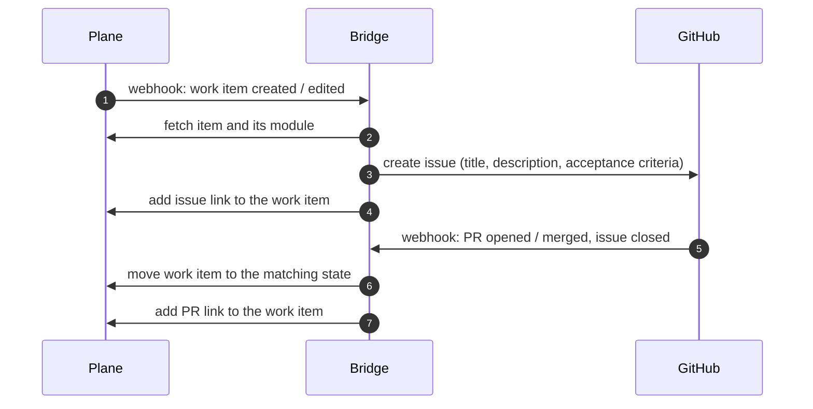

<div align="center">

# ⇄ plane-github-bridge

**Plan in Plane. Build in GitHub. Never update a board by hand.**

A small, self-hosted webhook service that links [Plane](https://plane.so) Community Edition work items to GitHub issues, built by [D5-Interactive](https://github.com/D5-Interactive).

[](https://github.com/D5-Interactive/plane-github-bridge/actions/workflows/ci.yml)
[](LICENSE)
[](https://www.python.org/)
[](https://github.com/astral-sh/uv)
[](https://fastapi.tiangolo.com/)
[](docker-compose.yml)
[](https://github.com/makeplane/plane)

[How it works](#-how-it-works) ·
[Installation](#-installation) ·
[Setup](#-setup) ·
[Linking repos](#-linking-plane-to-repos) ·
[Team workflow](#-team-workflow) ·
[Limits](#-limits) ·
[Reference](#-reference) ·
[Development](#-development)

</div>

---

## ◆ Why

Plane's built-in GitHub sync is a paid feature. This bridge gives Community
Edition the part that matters for a Scrum team:

- ▸ **Plane is where tasks are planned.** Write the task, its acceptance
  criteria and its estimate in Plane, inside a module that's mapped to a repo.
- ▸ **GitHub is where the code work happens.** The bridge creates the issue, and
  branches, commits and PRs attach to it the normal GitHub way.
- ▸ **Progress flows back on its own.** Opening, reviewing and merging PRs moves
  the work item across the sprint board.

## ◆ How it works



Both sides send webhooks **to the bridge**; the bridge is the only thing that
holds API keys for both. Every webhook is checked against its HMAC signature
before anything happens.

### State mapping

| On GitHub | Work item moves to |
|---|---|
| PR that says `Closes #N` opened as a draft | ◐ In Progress |
| PR ready for review | ◑ In Review |
| PR closed without merging, or converted to draft | ◐ In Progress |
| PR merged, or issue closed as completed | ● Done |
| Issue closed as not planned | ✕ Cancelled |
| Issue reopened | ○ Todo |

A PR counts as belonging to a work item if it says `Closes #N` for the linked
issue, or if its branch is named after the issue (`12-scan-command`).

### Activity feed

GitHub already shows branches, commits, PRs, reviews and merges on the issue.
The bridge copies that activity onto the Plane work item as comments, so the
same history is visible from either side:

| GitHub activity | Shows on the work item as |
|---|---|
| Branch created for the issue | ◆ comment + branch link |
| Commits pushed to the issue's branch, or mentioning `#N` | ◆ comment listing each commit |
| PR opened, ready for review, closed, reopened | ◆ comment + PR link |
| PR review: approved, changes requested, commented | ◆ comment |
| PR merged | ◆ comment, and the item moves to Done |

Each event is posted once, even if GitHub redelivers it.

### Edits

Edits to a work item's **title or description** in Plane are copied to its
issue. Edits made on the GitHub issue are **not** copied back: Plane is the
source of truth for the task itself.

## ◆ Installation

Everything runs on the Plane server, next to Plane. Clone the repo there:

```bash
cd ~
git clone https://github.com/D5-Interactive/plane-github-bridge.git
cd plane-github-bridge
```

**Requirements:**

- Docker with Compose v2
- A running Plane Community Edition instance on the same machine
- A GitHub organization (or personal account) that owns the repos to sync
- A way to give the bridge a public HTTPS address, such as a Cloudflare Tunnel
  or a reverse proxy

## ◆ Setup

The examples below use placeholder names. Replace them with your own:

| Placeholder | Means |
|---|---|
| `your-org` | Your GitHub organization (or username) |
| `plane.example.com` | The address your team uses to open Plane |
| `hooks.example.com` | The public address you give the bridge in step 5 |
| `your-workspace` | Your Plane workspace slug |

### 1. Create your config

```bash
cp .env.example .env
cp config.example.yaml config.yaml
chmod 600 .env
```

You fill in `.env` over the next steps. It holds the secrets: API tokens and
webhook secrets. Never commit it.

`config.yaml` can stay as it is. Repos are linked from inside Plane (see
[Linking Plane to repos](#-linking-plane-to-repos)); the file is only an
optional override for admins.

### 2. Plane API token

In Plane: your avatar → **Profile settings** → **Personal access tokens**
(called API tokens in some versions) → create one and copy it.

Open `.env` (`nano .env`) and paste it after `PLANE_API_KEY=`, with no quotes
or spaces:

```bash
PLANE_API_KEY=plane_api_0123456789abcdef
```

While you're in `.env`, fill in the three lines above it:

```bash
PLANE_BASE_URL=http://localhost:80              # Plane's port on this machine (LISTEN_HTTP_PORT in plane.env)
PLANE_PUBLIC_URL=https://plane.example.com      # the address your team opens Plane at
PLANE_WORKSPACE=your-workspace                  # the part after plane.example.com/ in your browser
```

> [!IMPORTANT]
> Copy `PLANE_WORKSPACE` from the address bar, not from the workspace's display
> name: in `https://plane.example.com/acme-team/projects/...` it's `acme-team`.
> A wrong slug makes every write fail with `403 You do not have permission`.

> [!NOTE]
> The bridge acts as this user. Plane's API only lets it edit projects the user
> is an explicit **member** of (role Member or Admin). Being the workspace
> owner isn't enough. Add the account to every project whose modules you'll
> link, under **Project → Settings → Members**.

### 3. GitHub token

Fine-grained tokens are created from a **user account**, then pointed at the
org. Sign in as the account the issues should come from: your own, or a
dedicated bot account if you'd rather the issues not show your name.

Create the token at <https://github.com/settings/personal-access-tokens/new>
(your avatar → **Settings → Developer settings → Personal access tokens →
Fine-grained tokens**):

| Setting | Value |
|---|---|
| Resource owner | `your-org` (not your username) |
| Repository access | **All repositories**, or only the repos you'll link |
| Permissions | **Issues → Read and write** (Metadata → Read is added automatically) |

That one permission is enough. (The automatic Metadata access lets the bridge
read a repo's description for the module header.) Commits, branches, PRs and
reviews reach the
bridge inside GitHub's webhook payloads (step 7), so the token never reads
them. Keeping it to Issues means a leaked token can't touch your code.

**All repositories** means linking a new repo is done entirely in Plane. With
**Only select repositories**, each new repo also has to be added to the token
before its issues can be created.

> [!NOTE]
> If `your-org` doesn't appear under Resource owner, an org owner has to allow
> fine-grained tokens first: **Org settings → Personal access tokens →
> Settings**. If the org requires approval, the owner then approves the token
> under **Pending requests**.

Then make up a secret for the GitHub webhook:

```bash
openssl rand -hex 32
```

Put both in `.env`, along with your org name:

```bash
GITHUB_TOKEN=github_pat_0123456789abcdef
GITHUB_WEBHOOK_SECRET=<the output of openssl rand -hex 32>
GITHUB_ALLOWED_OWNERS=your-org
```

`GITHUB_ALLOWED_OWNERS` limits which GitHub owners anyone in Plane can link to.
Separate several with commas; leave it empty to allow any repo the token can
reach.

Leave `PLANE_WEBHOOK_SECRET` empty for now; Plane gives you that one in step 6.
Until then the bridge starts but turns away Plane webhooks.

### 4. Start the bridge

```bash
docker compose up -d --build
```

The first build takes a minute or two. Give the bridge a few seconds to boot,
then check it:

```bash
sleep 5
curl http://127.0.0.1:8095/health
```

You should see:

```json
{"ok":true,"mappings":0,"plane_webhook_ready":false,"plane_api_ok":true,
 "queue":{"length":0,"oldest_age":0.0,"stale":0},"plane_pacer":{...},
 "github_pacer":{...},"scheduler":{...},"problems":{"open":0,...},"reconcile_pending":0}
```

The fields after `plane_api_ok` show the sync engine at work; they're explained
under [/health](#health). `mappings` counts admin overrides in `config.yaml`, so `0` is normal.
`plane_api_ok` is checked once at startup: `false` comes with a
`plane_problem` message saying what's wrong (usually the workspace slug or the
API token). A setup mistake like that keeps the catch-up sync off until you fix
it and restart. Temporary trouble (Plane rate-limiting the key, answering 5xx,
or unreachable) is shown as `"plane_problem": "temporary: ..."` with
`"plane_problem_temporary": true`; the catch-up sync starts anyway and clears it
after its first pass that gets through. `plane_webhook_ready`
stays `false` until step 6. The log also warns that `PLANE_WEBHOOK_SECRET` is not
set; that's expected for now.

If `curl` can't connect, check that the container is up and read its log:

```bash
docker compose ps                    # STATUS should be "Up", not "Restarting"
docker compose logs --tail 30 bridge
```

| Log says | Fix |
|---|---|
| `Missing required environment variable ...` | That line in `.env` is empty or misspelled |
| `IsADirectoryError` or a YAML error | `config.yaml` is missing, so Docker created a folder in its place. Run `docker compose down && rmdir config.yaml && cp config.example.yaml config.yaml`, fill it in, then start again |

### 5. Give it a public address

Plane and GitHub need to reach the bridge over HTTPS. Point a hostname such as
`hooks.example.com` at `http://localhost:8095` on this machine.

**With a Cloudflare Tunnel:** Zero Trust → **Networks → Tunnels** → your tunnel
→ **Add route → Published application**:

| Field | Value |
|---|---|
| Subdomain | `hooks` |
| Domain | `example.com` |
| Path | leave empty |
| Service URL | `http://localhost:8095` |

**With a reverse proxy** such as Caddy:

```
hooks.example.com {
    reverse_proxy 127.0.0.1:8095
}
```

Check it from a **different machine**, such as your laptop:

```bash
curl https://hooks.example.com/health
```

You should get the same `{"ok":true,...}` as in step 4.

> [!TIP]
> The bridge only listens on `127.0.0.1`, so your tunnel or proxy is the only
> way in. Only `/plane/webhook`, `/github/webhook`, `/health` and the
> [sync problem pages](#sync-problems) exist. Both webhooks reject anything
> without a valid signature, and the sync problem pages need a Plane API key.

### 6. Plane webhook

1. In Plane, open **Workspace settings → Webhooks → Add webhook**.
2. Fill in:

   | Field | Value |
   |---|---|
   | URL | `https://hooks.example.com/plane/webhook` |
   | Events | **Work items** (called Issues in some versions) and **Modules**. Projects, cycles and comments aren't needed |

3. Save. Plane shows a secret that starts with `plane_wh_`. Copy it; Plane may
   not show it again.
4. On the server, open `.env` and paste it in:

   ```bash
   nano .env
   ```

   ```bash
   PLANE_WEBHOOK_SECRET=plane_wh_0123456789abcdef
   ```

5. Recreate the container so it reads the new value. A plain `restart` does not
   reload `.env`:

   ```bash
   docker compose up -d --force-recreate
   sleep 5 && curl http://127.0.0.1:8095/health
   ```

   `plane_webhook_ready` should now be `true`.

### 7. GitHub webhook

One webhook on the organization covers every repo, including ones you add
later. If you aren't an org owner, add the same webhook to each mapped repo
under **Repo → Settings → Webhooks** instead.

1. On the server, print the webhook secret you made in step 3:

   ```bash
   grep '^GITHUB_WEBHOOK_SECRET=' .env
   ```

   GitHub doesn't generate this one; you give it the same value the bridge has.

2. On GitHub, open **your-org → Settings → Webhooks → Add webhook** and fill in:

   | Field | Value |
   |---|---|
   | Payload URL | `https://hooks.example.com/github/webhook` |
   | Content type | `application/json` (the default is form-encoded; change it) |
   | Secret | everything after `GITHUB_WEBHOOK_SECRET=` from step 1 |
   | SSL verification | Enable SSL verification (the default) |

3. Under **Which events would you like to trigger this webhook?**, choose **Let
   me select individual events**. A long checklist opens. **Push** is ticked by
   default; leave it ticked, and make sure exactly these six are on:

   - ✓ Branch or tag creation
   - ✓ Issues
   - ✓ Pull requests
   - ✓ Pull request reviews
   - ✓ Pushes
   - ✓ Repositories (so editing or renaming a repo triggers a check, see
     [How syncing works](#how-syncing-works))

   Leave every other box unticked. "Send me everything" also works, since the
   bridge ignores events it doesn't use, but it sends your server a lot of
   pointless traffic.

4. Keep **Active** ticked and click **Add webhook**.
5. Open the webhook again and select the **Recent Deliveries** tab. GitHub sends
   a ping as soon as the webhook is created; it should show a green ✓.

| Ping shows | Meaning |
|---|---|
| ✓ 202 | Working (202 means "accepted") |
| ✕ 401 | The secret doesn't match `.env`. Paste it again, or make a new one in both places |
| ✕ couldn't connect / 502 | GitHub can't reach the bridge. Recheck step 5 |

### 8. Try it

Link a module to a repo as described in
[Linking Plane to repos](#-linking-plane-to-repos), then create a work item in
that module. Within a few seconds a GitHub issue
appears and its link shows on the work item.

```bash
docker compose logs -f bridge
```

> [!IMPORTANT]
> If nothing happens, read the log first, then check the webhook's **Recent
> Deliveries** (GitHub) or delivery log (Plane), and `/health`.

## ◆ Linking Plane to repos

Only work items in a **linked module** go to GitHub. Everything else stays in
Plane, which keeps admin, planning and other organizational work off GitHub:

| Work item is in | Goes to GitHub? |
|---|---|
| A module whose description has a GitHub repo link | ✓ Yes, to that repo |
| A module with no repo link | ✕ No, stays in Plane |
| No module at all | ✕ No, stays in Plane |

Anyone who can edit a module in Plane can link it. No server access is needed.

1. In Plane, open the project → **Modules** → the module (or create one).
2. Paste the repo's GitHub URL **anywhere** in the module's description, for
   example `code is at https://github.com/your-org/auth-service, ask Sam`.
3. Save. Within a few seconds the bridge tidies the module, which is also how
   you can tell the link worked:
   - **Name** becomes the repo's name, e.g. `auth-service`.
   - **Links** gets the repo, titled `GitHub: your-org/auth-service` (see the
     note below on Plane versions).
   - **Start date** becomes the day the repo was created on GitHub.
   - **Description** becomes the repo link and the repo's GitHub description:

     ```
     https://github.com/your-org/auth-service
     Login, sessions and token refresh for the web app.
     ```

   If the repo has no description on GitHub, only the link is kept. To change
   that second line, edit the repo's **About** on GitHub, then save the module
   again.
4. That's it. Work items created in that module get an issue within seconds.
   Existing items moved into the module get theirs within about two minutes
   (see [Catch-up sync](#catch-up-sync)).

> [!NOTE]
> The tidy-up replaces everything else in the module's name and description, so
> keep notes in Plane Pages or the work items instead. If another module in the
> project already has the repo's name, only the description is updated. Nothing
> changes if the GitHub token can't see the repo or its owner isn't in
> `GITHUB_ALLOWED_OWNERS`.

Changes take effect within a minute. To unlink a module, remove the URL from
its description; issues that already exist stay linked.

> [!NOTE]
> Admins can also pin module mappings in `config.yaml`, which take priority over
> links set in Plane. See the comments in `config.example.yaml`. Mappings there
> match the module by name, so update them if the module is renamed.

## ◆ Team workflow

1. **Plan in Plane.** Create the task in a linked module and write the
   acceptance criteria as a checklist; it becomes a checklist on the GitHub issue.
2. **Branch from the issue.** On the GitHub issue: **Development → Create a
   branch**. GitHub names it like `12-scan-command`, which links the branch, its
   commits and its PR to the work item automatically.
3. **Close it from the PR.** Put `Closes #<issue number>` in the PR description.
   Commits on other branches show up too if their message mentions `#12`.
4. **Hands off the board.** Leave the Plane state alone; the bridge moves it.

## ◆ Limits

- Only work items in linked modules sync. Work items in unlinked modules or in
  no module stay in Plane. Moving an item into a linked module later creates its
  issue at the next membership pass, within about two minutes.
- Deleting a work item doesn't delete or close its issue.
- A PR only moves a work item if it says it closes the linked issue or its
  branch is named after it.
- Commit and review comments only reach Plane for issues the bridge created.
- State names should be **Todo, In Progress, In Review, Done** and
  **Cancelled**. Otherwise the bridge falls back to the first state in the
  matching state group.

## ◆ Reference

The exact rules the bridge follows. Everything here matches the code in
`bridge/`; if you change a rule, update this section with it.

### Events it listens to

| Source | Event | What the bridge does |
|---|---|---|
| Plane | Work item created / updated | Creates the GitHub issue if the item is in a linked module and has none yet (closed at once if the item is already done or cancelled); otherwise pushes title/description edits to its issue, and opens or closes the issue when the item moves between open and done/cancelled states |
| Plane | Work item deleted | Nothing. The issue stays |
| Plane | Module created / updated | Tidies the module if its description links a repo, and schedules a [check](#how-syncing-works) of the module against its repo |
| GitHub | `issues` closed / reopened | Moves the work item's state, unless it's already closed (or open) in Plane |
| GitHub | `issues` edited (title) | Copies the new title to the work item |
| GitHub | `pull_request` | Moves the state, adds the PR link and an activity comment |
| GitHub | `pull_request_review` submitted | Activity comment |
| GitHub | `push` | Activity comment listing the commits |
| GitHub | `create` (branch) | Activity comment and branch link |
| GitHub | `repository` edited / renamed / transferred | Schedules a [check](#how-syncing-works) of the repo against its module(s); a rename is checked under the old and new names |
| GitHub | `ping` | Replies so GitHub shows a green ✓ |
| Either | Anything else | Ignored and logged |

Every request is checked against its HMAC-SHA256 signature first:
`X-Plane-Signature` with `PLANE_WEBHOOK_SECRET`, `X-Hub-Signature-256` with
`GITHUB_WEBHOOK_SECRET`. A bad or missing signature gets `401` and nothing else
happens. A good one gets `202 Accepted` at once and is processed in the
background, so Plane and GitHub never wait on the bridge. Each delivery is
handled once: Plane's `event_id` and GitHub's `X-GitHub-Delivery` are recorded
after the delivery's actions have run or been queued, and a redelivery of the
same ID is ignored.

### How syncing works

**Every change goes out at once.** Each write the bridge makes (creating an
issue, pushing a title or description edit, moving a state, adding a link,
posting an activity comment, tidying a module) is an *action*. It runs as soon
as the webhook arrives. If it fails for a reason that may pass (a rate limit,
a 5xx, a timeout, Plane or GitHub unreachable), the action goes into the
**retry queue** with what it was meant to do; it is never dropped. If it fails
for a lasting reason (GitHub `403`/`404`/`410`/`422`, Plane saying the item
doesn't exist), it isn't retried and is recorded as a
[sync problem](#sync-problems) instead.

**The retry queue** lives in the database, so it survives restarts. Every 2
seconds the bridge runs the actions that are due, waiting 5, 15, 30, 60 and
then 120 seconds between attempts. A newer action of the same kind for the same
item replaces the older one, so only the latest intent runs. Every change to an
item's state or title (from a webhook or a check) shares one entry per item, so
a "close" and a later "reopen" can't both be waiting; while that entry waits,
new changes to the item queue behind it instead of jumping ahead. Changes are
merged in the order they arrived: a later change to open/closed on either side
replaces an earlier one still waiting (a person moving the item in Plane beats
an older "move to Done" from GitHub that hadn't gone through yet), and when the
entry runs, a GitHub-driven move is first checked against the issue as it is
then. A change merged in while the entry is running stays queued and runs next. Each action
runs in the [pacing lane](#api-usage) it came from. A rate limit ends the round,
and the next one starts when the [pacer](#api-usage) allows. An
action still waiting after `BRIDGE_QUEUE_MAX_AGE` seconds (default 300) is
flagged as a `stuck` sync problem; it keeps retrying, and the flag clears when
it succeeds.

**Nothing is done twice.** Before a queued action runs again, the bridge reads
the current state, because the first attempt may have worked and only its
answer was lost:

| Queued action | Checked first |
|---|---|
| Create an issue | Is the item already linked to an issue? Then only its link is added. Otherwise, is there a recent issue in the repo that the bridge made for this item (its body links the item, or it has the item's exact title and the bridge's marker)? Then that issue is linked instead of creating another. Every create looks for such an issue first, not only retries; and while a create waits in the queue, webhooks, checks and the membership pass leave the item to it |
| Add a link | Is the URL already on the Plane item? |
| Sync an item's state or title | Reads both sides again and decides again, the way a check does: a queued "close the issue" does nothing if the item was reopened meanwhile |
| Post a comment | Was this activity already recorded as posted? On a retry, is a comment with the same text already on the item? |
| Push an edit | Is the issue's title already what the bridge last sent? |
| Tidy a module | Uses the module as it is now, not as it was |

**Its own changes don't come back.** The bridge records the last value it wrote
to each field (an issue's open/closed state or title, a work item's state or
title) for 10 minutes. A webhook is ignored as the bridge's own change only if
it reports exactly that value and the bridge's record of the pair still holds
it. Each write matches one webhook at most, and any other change to the field
forgets it, so a person flipping a field away and back (B to C to B) within the
10 minutes is still synced. An issue closed or reopened on GitHub also doesn't move a work
item that's already closed (or open) in Plane, so a reopen doesn't knock an
In Progress item back to Todo.

**Checks of edited modules and repos.** Editing a linked module in Plane, or
editing, renaming or transferring its repo on GitHub, schedules a check of that
module against that repo. Edits that come in a burst are combined: the check
runs once, `BRIDGE_RECONCILE_DELAY` seconds (default 30) after the last one. A
check lists the module's items and the repo's issues and compares each pair:

| Found | What the bridge does |
|---|---|
| An item with no issue | Creates the issue (unless a create for it is already waiting in the queue) |
| An issue link missing from the item | Adds it |
| The title or open/closed state changed on one side since the last sync | Copies it to the other side |
| Open/closed changed on both sides since the last sync, and they differ | If both change times are known (GitHub's `closed_at`, or `created_at` for an issue never closed; Plane's `completed_at`), the later one wins, and the conflict is recorded without a label. Otherwise flagged as `state_differs`; nothing is written |
| The title changed on both sides, and they differ | Flagged as `title_differs`; nothing is overwritten |
| A pair the bridge hasn't seen since the upgrade (first contact) | See below |
| The item's issue no longer exists in the repo | Flagged as `issue_missing` |
| Issues in the repo with no Plane item | Counted as one `unlinked_issues` problem for the repo; no issue is labeled |

The bridge never decides by an item's or issue's "last updated" time: labels,
comments and assignees change it too, so it says nothing about which title or
state is newer.

Fixes go through the same actions as webhooks, so a fix that fails is queued
and retried like any other. A rate limit or rejected key while applying a fix
ends the check, and the fix waits in the queue. After every sync of a pair the
bridge records **both sides as they actually are** (each side's title and
open/closed state), which is how a later check tells which side changed. A
difference both sides already had at that point (for example an item moved to
Done by a merged PR whose issue stayed open) is left alone.

**First contact.** A pair with nothing recorded yet (every pair synced before
this version) gets its first record from the first check that sees it. If the
two sides differ then, the bridge can't tell which is right, so it **writes
nothing** and flags `state_differs` or `title_differs` for a person to settle.
The flag clears by itself once the two sides match. With
`BRIDGE_FIRST_CONTACT_FIX=1`, open/closed differences are fixed instead where
both change times are known (for example an item completed in Plane after its
issue was opened, and the issue never closed: the issue is closed); titles are
always left to a person.

> [!NOTE]
> A work item moved to a **completed** or **cancelled** state in Plane now
> closes its GitHub issue at once (as completed or not planned), and reopening
> it reopens the issue. An issue **title** edited on GitHub now reaches Plane at
> once. Before, only GitHub → Plane state changes and Plane → GitHub title edits
> were synced.

**The membership pass.** Plane sends no webhook when an existing work item is
added to a module, so every `BRIDGE_MEMBERSHIP_INTERVAL` seconds (default 120)
a light pass lists the linked modules' items and creates issues for new ones
(see [Catch-up sync](#catch-up-sync)). An item that fails with a temporary
error goes into the retry queue; an item already waiting in the queue is left
to it.

**Large repos.** A check after an edit lists only the issues changed since the
module's last check against that repo (GitHub's `since`, kept per module, so
one module's check doesn't hide changes from another module linked to the same
repo); linked issues it didn't list are read one
by one only when their Plane side changed. The org scan lists every issue. If a
repo has more than 5,000 issues (the listing's 50-page cap), linked issues past
the cap are read one by one rather than reported missing, and `unlinked_issues`
isn't updated from the partial list.

**The org scan.** Less often, the bridge checks every linked module against its
repo across the whole workspace, so drift is found even when nothing is being
edited. Each scan measures how long it took, how many API calls it made, the
CPU it used and the host's load, and the bridge picks when to run the next one
from that:

| The last scan was | Next scan |
|---|---|
| Quick (2 minutes or less), light (300 API calls or fewer, 30 CPU seconds or less) and the host not busy | 6 hours later |
| Quick but heavy (more calls or CPU, or load average above 1.5 per CPU) | At the next 06:00 or 18:00 in `BRIDGE_TIMEZONE`, at least 12 hours after the last scan |
| Slow (over 2 minutes) | At the start of the next quiet hours (`BRIDGE_QUIET_HOURS`, default 1-5, in `BRIDGE_TIMEZONE`) |

> [!IMPORTANT]
> The quiet hours are local to `BRIDGE_TIMEZONE`, which is **UTC** unless you set
> it. Set it to your team's time zone (for example `America/New_York`), or
> "1-5" means 1-5 a.m. UTC.

The first scan after the bridge is installed waits for the quiet hours. The
schedule is kept in the database, so a restart doesn't reset it. A slow scan
only starts inside the quiet hours: if they're over when it comes due (the
bridge was down, or the scan was postponed past their end), it waits for the
next night. A scan that's due while
the host is busy (load average above 1.5 per CPU) waits 15 minutes. A scan cut
short by a rate limit or a rejected key isn't measured and is tried again in 15
minutes. A workspace admin can ask for a scan now with
`POST /admin/scan` (header `X-API-Key: <their Plane API key>`); it runs within
a few seconds. Set `BRIDGE_ORG_SCAN=0` to turn the org scan off, or
`BRIDGE_RECONCILE=0` to turn off checks and the org scan together. Checks
waiting for their burst of edits to settle are kept in the database across
restarts.

Scans, checks and the membership pass use the **background lane**: they only
use part of the rate-limit budget and step aside whenever a webhook or a
queued retry is waiting (see [API usage](#api-usage)).

### Sync problems

Anything the bridge can't settle on its own is a **sync problem**:

| Kind | Meaning | Flagged | Clears when |
|---|---|---|---|
| `stuck` | A queued action is still failing after `BRIDGE_QUEUE_MAX_AGE` seconds | Item and issue | The action succeeds |
| `refused` | Plane or GitHub refused an action for a lasting reason | Item and issue | A later action on the item succeeds, or the item is edited in Plane (it's tried again) |
| `state_differs` | Open on one side, closed on the other, and the bridge can't tell which is right (first contact, or both changed) | Item and issue | The two sides match |
| `title_differs` | The titles differ and the bridge can't tell which side is right | Item and issue | The two sides match |
| `issue_missing` | The item's linked issue is gone from the repo | Item | A check finds the issue again |
| `unlinked_issues` | Issues in a linked repo with no Plane item | No | The repo has none |
| `conflict` | Open/closed changed on both sides; the side with the later known change time won | No (recorded as settled) | Already settled |
| `closed_by_merge` | The bridge closed an issue because a PR from its branch merged (see [State changes](#state-changes)) | No (informational) | Already settled |

A flagged work item gets a red **sync problem** label in Plane, and its GitHub
issue a **plane-sync-problem** label, so people see that something is off
without a comment landing in the work. Both labels are created on first use and
removed when the item has no open problem left. If adding or removing a label
fails, the bridge tries again every 5 minutes. Problems are stored with IDs and
short values only, never descriptions or comments.

The details are on the bridge, not in Plane or GitHub. Set `BRIDGE_PUBLIC_URL`
to the bridge's public address (for example `https://hooks.example.com`) so
the labels' descriptions point there:

- `GET /status/PROJECT-12` with header `X-API-Key: <your Plane API key>`: the
  open and recently resolved problems of one work item. Anyone who can read the
  item in Plane can read this.
- `GET /admin/sync-problems` with an admin's key: every open problem, filtered
  by `?repo=`, `?project=` or `?kind=`.

The admin pages check the key with Plane on every request: it must belong to a
workspace admin (role 20) who isn't a bot account. The key is used only for that
check and is never stored or logged. Each client address may make 30 requests
a minute to these pages; more get `429`. The address is the connection's own,
unless `BRIDGE_TRUST_PROXY_HEADERS=1`, which takes it from `CF-Connecting-IP` or
`X-Forwarded-For`.

> [!IMPORTANT]
> Behind a Cloudflare Tunnel or a reverse proxy every request reaches the bridge
> from the tunnel or proxy, so all callers share one limit. Set
> `BRIDGE_TRUST_PROXY_HEADERS=1` there. Leave it off when nothing in front sets
> those headers, or callers could pick their own address.

### /health

| Field | Meaning |
|---|---|
| `ok`, `mappings`, `plane_webhook_ready`, `plane_api_ok`, `plane_problem`, `plane_problem_temporary` | See [setup step 4](#4-start-the-bridge) |
| `queue` | `length`: actions waiting to be retried; `oldest_age`: seconds the oldest has waited; `stale`: how many were flagged `stuck` |
| `plane_pacer`, `github_pacer` | The pacing in force. `source`: `headers` (learned from the last response), `configured` (`PLANE_RATE_LIMIT`, until headers are seen) or `off`; `limit` and `limit_source` (`header`, or `inferred`, see [API usage](#api-usage)); `remaining`, `reset_in`; `interval` and `background_interval` (seconds between calls); `background_blocked_for`; `reserve_share`; `hold_in` (seconds left of a hold after a 429); `waiting` (callers waiting per lane) |
| `scheduler` | The org scan: `class` of the last scan (`light`, `heavy`, `slow`), `next_run`, `last_run` and its measurements in `last`, and `quiet_hours_only` (the next run may only start in the quiet hours); `{"enabled": false}` when the org scan or checks are off |
| `problems` | `open` sync problems, `by_kind`, and `flags_pending` (label changes waiting to be retried) |
| `reconcile_pending` | Module and repo checks waiting for their burst of edits to settle |

### Settings

Set in `.env`. Only the first block in `.env.example` is required.

| Setting | Default | What it does |
|---|---|---|
| `BRIDGE_MEMBERSHIP_INTERVAL` | `120` | Seconds between membership passes; `0` turns the membership pass off (the retry queue and checks keep running). `BRIDGE_SYNC_INTERVAL` is still read if this isn't set |
| `BRIDGE_RECONCILE` | `1` | `0` turns off checks of edited modules and repos and the org scan. The retry queue always runs |
| `BRIDGE_FIRST_CONTACT_FIX` | `0` | `1`: on a pair's first check, fix open/closed differences where both change times are known, instead of only flagging them (see [How syncing works](#how-syncing-works)) |
| `BRIDGE_QUEUE_MAX_AGE` | `300` | Seconds a queued action may keep failing before it's flagged `stuck` |
| `BRIDGE_RECONCILE_DELAY` | `30` | Seconds of quiet after the last module or repo edit before its check runs |
| `BRIDGE_ORG_SCAN` | `1` | `0` turns the org scan off |
| `BRIDGE_TIMEZONE` | `UTC` | Time zone for the quiet hours and the 06:00 / 18:00 slots, as an IANA name such as `America/New_York`. **Set it**: the default puts the quiet hours at night in UTC |
| `BRIDGE_QUIET_HOURS` | `1-5` | Start and end hour (0-23, different) of the quiet window for slow scans; it may wrap midnight, such as `22-4` |
| `BRIDGE_TRUST_PROXY_HEADERS` | `0` | `1`: take client addresses for the sync problem pages' rate limit from `CF-Connecting-IP` / `X-Forwarded-For`. Set it behind a Cloudflare Tunnel or reverse proxy |
| `BRIDGE_RATE_RESERVE_SHARE` | `0.3` | Share of each rate-limit window kept for webhooks and retries; background work uses the rest |
| `BRIDGE_PUBLIC_URL` | empty | The bridge's public address, shown in sync problem labels |
| `PLANE_RATE_LIMIT` | `50` | Requests per minute for Plane until its headers have been seen |

### Catch-up sync

This is the membership pass from [How syncing works](#how-syncing-works).
Plane sends **no webhook** when an existing work item is added to a module.
Without help, an item created first and then dragged into a linked module would
never reach GitHub. So every `BRIDGE_MEMBERSHIP_INTERVAL` seconds (default 120,
and once at startup) the bridge:

1. adds any issue links that never reached Plane (up to 10 per pass, least
   recently tried first; see below),
2. lists the workspace's projects and their modules,
3. picks the modules linked to a repo (description URL or `config.yaml`) whose
   owner is allowed; projects with none are skipped without listing anything,
4. lists each linked module's items once, and creates an issue for every item
   that doesn't have one yet.

Items that already have an issue are skipped, so it never creates duplicates.
Projects the token's account can't read are skipped quietly. A pass costs one
Plane API call for the project list, one per project for its modules, one per
linked module, and a few per new item, so a quiet pass stays cheap however many
items your modules hold.

When something goes wrong:

| What happens | What the pass does |
|---|---|
| One item fails | Logs one line with the project and item ID and the reason, then carries on with the rest |
| GitHub refuses the item for a lasting reason (repo gone, Issues disabled, no access: 403, 404, 410, 422) | Parks it for that repo and skips it for 6 hours, logging one line per repo and recording a `refused` sync problem. Editing the item in Plane, linking its module to a different repo, or restarting the bridge retries it at once |
| Any other error (Plane errors other than 429 and 401, GitHub 5xx, timeouts, network) | Puts the item's issue in the retry queue, which tries again within seconds |
| Plane or GitHub rate-limits the bridge (429, or GitHub's secondary rate limit), anywhere in the pass | Stops the pass at once instead of hammering the API; the next pass picks up where it left off |
| Plane or GitHub rejects the key or token (401) | Stops the pass with one log line; nothing is parked, so fixing the credential and waiting a pass is enough |
| The issue was created but adding its link to the Plane item failed | The link is recorded as missing and added by a later pass, so the issue is never created twice. If adding it answers 404, the bridge asks Plane for the work item itself, and stops trying only if Plane says it doesn't exist. A 404 page from a proxy (while Plane restarts) counts as temporary |
| An item is listed in a linked module but Plane says it doesn't exist | Parks it like a lasting refusal (6 hours, or until it's edited or the bridge restarts), so it isn't read every pass |

The log gets one summary line per pass, and only when the pass did something.

The pass only creates **missing issues** and adds **missing issue links**. Other
work whose webhook action failed (an edit, a state change, a comment) is in the
retry queue, and drift that slipped past everything is found by the
[checks](#how-syncing-works).

### Deciding whether a work item goes to GitHub

When a work item without an issue is created or updated, the bridge looks for a
repo in this order and stops at the first match:

1. **`config.yaml`** mappings for the item's project, if the item is in that
   mapping's module.
2. **Module descriptions:** each module in the project whose description holds a
   `https://github.com/owner/repo` URL, if the item is in that module.
3. **No match:** the item stays in Plane. The log says
   `kept in Plane: item isn't in a module linked to a repo`.

Then two last checks: the repo's owner must be in `GITHUB_ALLOWED_OWNERS` (when
that's set), and the token must be able to create issues there.

Details:

- The URL can be anywhere in the description, in plain text or as a link.
  `.git` endings and trailing paths like `/issues/3` are ignored. The first
  GitHub repo URL wins.
- Project descriptions are **not** read. An item in no module never syncs.
- An item in several linked modules goes to the first one Plane lists.
- Module and project details are cached for 60 seconds, so a new link takes up
  to a minute to apply.
- An item gets at most one issue, ever. Moving it to another module afterwards
  doesn't create a second issue or move the existing one.

### What the GitHub issue contains

| Issue field | Comes from |
|---|---|
| Title | The work item's name |
| Body | The work item's description, converted to GitHub Markdown |
| Footer | `Synced from Plane work item [ALL-12](link). Plan, estimate and edit the task in Plane; do the code work here.` |

Plane checklists become GitHub task lists: an unchecked item is `- [ ]`,
a checked one `- [x]`. Headings, lists, bold, links and code carry over.

The work item gets a link back, titled `GitHub owner/repo#12`.

### Edits after the issue exists

- **Plane → GitHub:** when the work item's **title or description** changes, the
  bridge rewrites the issue's title and body from the work item. Other fields
  (assignees, labels, priority, estimate, dates) aren't copied.
- **GitHub → Plane:** an issue **title** edited on GitHub is copied to the work
  item at once. The issue's body is never copied back, and the next Plane edit
  to the description overwrites it. Treat Plane as the source of truth for the task's
  wording.

### How PRs, branches and commits find their work item

GitHub activity is matched to a work item through the issue the bridge created.
Activity on any other issue is ignored.

| Activity | Matched when |
|---|---|
| Pull request | Its title or body says `close`, `closes`, `closed`, `fix`, `fixes`, `fixed`, `resolve`, `resolves` or `resolved` followed by `#12` (or `owner/repo#12`), **or** its branch is named after the issue |
| Branch | Its name starts with the issue number: `12-scan-command`, `12_scan`, `feature/12-scan` |
| Commit | It's pushed to a branch named after the issue, **or** its message mentions `#12` anywhere |
| Review | It's on a PR that matches, by the PR rules above |

### State changes

| On GitHub | Work item moves to |
|---|---|
| PR opened as a draft, converted to draft, or closed without merging | In Progress |
| PR opened (not draft), marked ready, reopened, edited, or new commits pushed to it | In Review |
| PR merged | Done (and see below for the issue) |
| Issue closed as completed | Done |
| Issue closed as not planned | Cancelled |
| Issue reopened | Todo |

The bridge finds each target state by **name** first (`Todo`, `In Progress`,
`In Review`, `Done`, `Cancelled`, case-insensitive) and otherwise takes the
first state in the matching Plane state group (unstarted, started, completed,
cancelled). With no `In Review` state, PRs in review land in the first
"started" state. If the work item is already in the target state, nothing is
sent.

**Merged PRs from the issue's branch.** GitHub only closes an issue on merge when
the PR says `Closes #12`. When a PR from a branch named after the issue (such
as `12-scan`) merges and the work item moves to Done through it, the bridge
closes the issue as completed too, and posts one comment on it saying it was
closed because PR #N merged and the work item moved to Done, so the issue's
subscribers are told. The comment is posted once per PR, even if GitHub
redelivers the event, and the close is recorded as an informational
`closed_by_merge` entry in the item's history on `/status` (no label).

The other way, moving the work item into a completed or cancelled state closes
its issue (as completed or not planned), and moving it back to any other state
reopens it. A [check](#how-syncing-works) does the same for a change whose
webhook was missed. A new issue for an item that's already done or cancelled is
closed right after it's created.

### Activity comments

Comments are posted by the Plane account that owns `PLANE_API_KEY`, and start
with `◆ GitHub ·`.

| Activity | Comment | Also adds a link |
|---|---|---|
| Branch created | `branch 12-scan created by zep` | The branch |
| Push | `3 commits pushed to 12-scan by zep`, then each commit's short hash (linked) and first line, up to 10, then "…and N more" | ✕ |
| PR opened / ready / converted / closed / reopened / merged | `PR repo#5 "Add scan" merged into main by zep` | The PR, the first time it's seen |
| Review | `lead ✓ approved PR repo#5`, `✕ requested changes on`, or `commented on` (empty review comments are skipped) | ✕ |

Each one is posted once. The bridge records what it has posted for each work
item (each commit, branch, review and PR event), so a commit is listed only the
first time it's pushed, and a redelivered GitHub event posts nothing new. Commit messages and
names are HTML-escaped, so nothing in a commit can inject markup into Plane.

### Module tidy-up

Runs when Plane reports a module was created or updated, and whenever a work
item is synced through a module. If the module's description links a repo that
the token can see and the owner is allowed:

1. **Name** → the repo's name (`auth-service`). If another module in the
   project already has that name, Plane refuses the rename and the rest still
   happens.
2. **Description** → the repo link, then the repo's GitHub description (its
   **About** text). No About text, just the link.

3. **Start date** → the day the repo was created on GitHub (its `created_at`,
   in UTC). This is the repo's creation date, not its first commit: reading
   commits would need a token that can read code. For a repo created on GitHub
   they're normally the same day; for one pushed from older local history,
   the first commit can be earlier. Plane refuses a start date after the
   module's target date; then the start date is left as it was.
4. **Links** → the repo URL, titled `GitHub: owner/repo`, added once. Plane's
   public API doesn't document module links, so this is best effort: if your
   Plane version doesn't accept it, the bridge logs
   `this Plane's API has no module links endpoint` once, stops trying, and the
   renamed module and its description serve as the confirmation instead.

The comparison is on the visible text, so the `module.updated` webhook caused by
the bridge's own edit changes nothing and can't loop. Anything else that was in
the description is replaced.

### What's stored

A SQLite database at `/data/bridge.db`, in the `bridge-data` Docker volume:

| Table | Holds |
|---|---|
| `links` | Work item ↔ GitHub issue pairs, and whether the issue link reached the Plane item. This is what makes "one issue per item" work |
| `seen_events` | Plane event IDs, to drop Plane's retries |
| `posted` | Which commits, branches, reviews and PR events were already posted per item |
| `pr_links` | Which PR links were already added per item |
| `sync_failures` | Items GitHub refused for a lasting reason, with the repo and when, so the catch-up sync waits before retrying them. Cleared at every startup |
| `retry_queue` | Actions waiting to be retried: what they're meant to do, why the last try failed, and when the next is due |
| `pair_snapshot` | Per synced pair: each side's title and open/closed state after the last sync, so a check can tell which side changed |
| `repo_checks` | When each module was last checked against its repo, for listing only the issues changed since |
| `pending_checks` | Module and repo checks waiting for their burst of edits to settle |
| `scan_state` | The org scan's schedule and last measurements |
| `bridge_writes` | The last value the bridge wrote to each field of each item, to recognise the webhook it causes |
| `sync_problems` | Sync problems, open and resolved, with IDs and short values only |
| `sync_flags` | Which items and issues carry a sync problem label, and label changes still to retry |

> [!WARNING]
> Deleting the volume (`docker compose down -v`) forgets every link. The next
> edit to an already-synced work item would then create a **second** GitHub
> issue. Back the volume up with the rest of your server.

#### Upgrading and rolling back

**Upgrading to the sync engine** (retry queue, checks, org scan, sync
problems):

1. Add the new settings you want to `.env` (see [Settings](#settings)); all have
   working defaults. `BRIDGE_SYNC_INTERVAL` is still read, but rename it to
   `BRIDGE_MEMBERSHIP_INTERVAL`. Set `BRIDGE_PUBLIC_URL`, and set
   `BRIDGE_TIMEZONE` so the quiet hours are your night, not UTC's.
2. Tick **Repositories** in the GitHub webhook's events (setup step 7).
3. Rebuild and recreate the container. The new tables are created at startup;
   nothing existing changes.
4. Expect some flags, not changes: pairs synced before the upgrade have no
   record yet, so the first check of each (at the latest, the first org scan in
   the quiet hours) records both sides as they are. Where they differ, for
   example items done in Plane whose issues are still open, it writes nothing
   and flags `state_differs` or `title_differs` (see
   [First contact](#how-syncing-works)). Settle them by hand and the flags
   clear, or set `BRIDGE_FIRST_CONTACT_FIX=1` before the first scan to have
   open/closed fixed where the change times are reliable.

   On a big workspace this can label many items at once. To work through them:
   list them with `GET /admin/sync-problems?kind=state_differs` (and
   `?kind=title_differs`), then make each pair match on whichever side is right
   (close or reopen the issue, or move the work item; fix the title on one
   side). The next check of that module, or the next org scan, sees them match
   and removes the labels; `POST /admin/scan` runs a scan within seconds instead
   of waiting. If most are items done in Plane with issues left open, setting
   `BRIDGE_FIRST_CONTACT_FIX=1` and asking for a scan closes those whose times
   are reliable; the rest stay flagged for a person.
5. Optionally raise Plane's own limit (see [API usage](#api-usage)).

Rolling back to the version before is safe: it ignores the new tables. Actions
still in the retry queue at that moment aren't run, so check that `/health`
shows `"queue":{"length":0,...}` first.

Upgrading migrates the database by itself: the `links` table gains the
`plane_linked` and `last_link_attempt` columns, and `sync_failures` is created
or rebuilt. Rows that existed before the upgrade count as linked in Plane.

**Rolling back** to a version from before these columns existed is **not
safe** as it is: the older code saves links with five values, the table now has
seven columns, and every save fails *after* the GitHub issue was created, so
each event makes another duplicate issue. If you must roll back, run these steps
from a checkout of **this** version, before switching, so the image is the one
that knows the new columns:

1. **Let pending link repairs finish.** Dropping the columns makes every row
   look linked, so a link still waiting to be added would never be. This
   prints how many are waiting; go on when it says `0`:

   ```bash
   docker compose run --rm bridge python -c \
     "import sqlite3; print(sqlite3.connect('/data/bridge.db').execute('SELECT COUNT(*) FROM links WHERE plane_linked = 0').fetchone()[0])"
   ```

2. **Stop the bridge, back up the database and remove the new columns.** This
   uses the bridge's own image (its Python includes SQLite), so it needs no
   internet access. The backup is `bridge.db.bak` in the same volume:

   ```bash
   docker compose stop bridge
   docker compose run --rm bridge python -c "
   import shutil, sqlite3
   shutil.copy('/data/bridge.db', '/data/bridge.db.bak')
   db = sqlite3.connect('/data/bridge.db')
   db.execute('ALTER TABLE links DROP COLUMN last_link_attempt')
   db.execute('ALTER TABLE links DROP COLUMN plane_linked')
   db.execute('DROP TABLE IF EXISTS sync_failures')
   db.commit()"
   ```

3. Check out the older version and start it as usual.

**Re-checking issue links.** Links lost before this version (when a pass died
between creating the issue and adding its link) aren't known to the database.
To have the bridge check every link once, set `BRIDGE_RECHECK_LINKS=1` in
`.env` and recreate the container. At startup it marks every link as
"maybe missing", and the catch-up sync re-adds them 10 per pass. Plane refuses
a link URL an item already has, so items that kept their link are left as they
are. When the log stops showing `sync: repaired ...` lines, remove the setting
and recreate the container again, or the next restart re-checks everything.

### Security model

- The bridge listens on `127.0.0.1:8095` only; a tunnel or reverse proxy is the
  only way in.
- Both webhooks need a valid HMAC signature. An unset `PLANE_WEBHOOK_SECRET`
  rejects every Plane webhook with `503` rather than accepting unsigned ones.
- The GitHub token needs only **Issues: Read and write** (plus the automatic
  **Metadata: Read**). It can't read or change code.
- `GITHUB_ALLOWED_OWNERS` stops anyone in Plane from pointing a module at a repo
  outside your org.
- `/status/...` and the `/admin/...` pages check the caller's own Plane API key
  with Plane on every request; the admin pages accept only workspace admins
  who aren't bot accounts. The key is never stored or logged.
- The container runs as an unprivileged user.

### Reading the log

`docker compose logs -f bridge` prints one line per event:

| Log line | Meaning |
|---|---|
| `plane: created owner/repo#12` | New issue made for a work item |
| `plane: kept in Plane: ...` | The item isn't in a linked module; working as intended |
| `sync: created owner/repo#12, ...` | The catch-up sync found items added to linked modules and made their issues |
| `sync: repaired 2 Plane link(s)` | Issue links that didn't reach Plane earlier were added |
| `sync: API item ... failed, queued for retry (...)` | One item hit a temporary error and went into the retry queue; the rest of the pass went on |
| `create_issue for ... failed (...); queued for retry` | A webhook's action hit a temporary error; the retry queue runs it again within seconds |
| `retried create_issue: done` | A queued action went through |
| `found owner/repo#12 from an earlier attempt for API-7; linking it instead of creating another` | A retry found the issue its first attempt made; no duplicate |
| `... was refused (...); not retrying` | A lasting refusal; see `/admin/sync-problems` |
| `sync problem stuck: ...` (or `refused`, `title_differs`, ...) | A [sync problem](#sync-problems) was recorded and flagged |
| `sync note conflict: ...` | Both sides changed; the more recent change won and was copied over |
| `couldn't add the sync-problem label on ... ; will retry` | Flagging failed; retried every 5 minutes |
| `checked owner/repo: 3 item(s), 1 fix(es), 0 conflict(s)` | A module or repo check fixed something |
| `synced owner/repo#12: closed on GitHub` (or `title to Plane`, ...) | An item's state or title was synced between the two sides |
| `github:issues: ignored: the bridge's own change` | GitHub's webhook for a change the bridge made; harmless |
| `checks postponed (...)` | A rate limit or rejected key during a check; it runs again after the delay, and its fix waits in the queue |
| `org scan: 4 pair(s), ...; next as light` | An org scan finished, and when the next one runs |
| `org scan postponed 15 minutes: the host is busy` | The host's load was high when the scan came due |
| `sync: owner/repo refused items from API (...); parked for 6h ...` | GitHub refused items for a lasting reason, such as Issues being disabled or the token lacking access. Fix it and edit the item, or restart the bridge |
| `sync: stopped early, will resume next pass (... answered 429 ...)` | Plane or GitHub rate-limited the bridge; the catch-up sync loses nothing |
| `sync: stopped, a key or token was rejected (...)` | `GITHUB_TOKEN` or `PLANE_API_KEY` is wrong or expired; the sync tries again every pass |
| `sync: work item ... is gone from Plane; not adding the link ...` | The item was deleted after its issue was made; harmless |
| `sync: cleared 3 parked item(s); they'll be tried again` | Startup: items parked before the restart get a fresh try |
| `BRIDGE_RECHECK_LINKS is set: re-checking ...` | The one-off link re-check is on; remove the setting when it's done |
| `catch-up sync of linked modules every 120s` | Startup message; the sync is on |
| `plane: updated owner/repo#12` | Title/description edit pushed to the issue |
| `plane: module tidied for owner/repo` | Module renamed, description rewritten and/or repo link added |
| `this Plane's API has no module links endpoint` | Your Plane can't take module links from the API; name and description still update |
| `plane: unchanged: module already tidy` | The bridge's own edit coming back; harmless |
| `plane: ignored: token can't see owner/repo` | Add the repo to the GitHub token, or fix the URL |
| `plane: ignored: ... GITHUB_ALLOWED_OWNERS` | The module links a repo outside the allowed owners |
| `plane: ignored: duplicate delivery` | Plane retried an event already handled |
| `github:push: ignored: commits don't touch a linked issue` | A push unrelated to any synced work item |
| `github:pull_request: moved to review` | State changed on the work item |
| `... failed` followed by a traceback | Something errored; the event is skipped and the bridge keeps running |
| `WARNING PLANE_WEBHOOK_SECRET is not set` | Expected until setup step 6 is done |
| `PLANE SETUP PROBLEM: Plane refused workspace '...'` | `PLANE_WORKSPACE` doesn't match the slug in your Plane URL |
| `Plane isn't answering normally at startup (...); starting the catch-up sync anyway` | Plane was rate-limiting, down or unreachable at startup; the sync retries every pass |
| `Plane's API is answering again` | The temporary startup problem cleared; `/health` shows `plane_api_ok: true` again |
| `sync: API item ... is listed in a module but Plane says it doesn't exist; parked for 6h` | A deleted work item is still in a module's list; harmless |
| `... -> 403: You do not have permission to perform this action.` | The token's account isn't a member of that project, or the slug is wrong |
| `Plane rate limit: GET /... answered 429; waiting 10s (retry 1 of 3)` | Plane's per-key limit was hit; the bridge waits and retries. If it's frequent, lower `PLANE_RATE_LIMIT` |
| `GitHub rate limit: POST /repos/... answered 403; waiting 60s and retrying once` | GitHub's secondary rate limit, usually from creating many issues quickly; harmless |

The log never contains keys, tokens or work item content: only IDs, repo names,
issue numbers, HTTP methods, paths and status codes.

### API usage

Per Plane event the bridge makes a handful of Plane API calls (the work item,
plus the project and module list when they're not cached) and at most one or two
GitHub calls.

**Plane's rate limit.** Plane limits each API key to a number of requests per
minute (60 by default) and answers `429 RATE_LIMIT_EXCEEDED` above it. The
bridge keeps itself under the limit and recovers when it hits it anyway:

- **Learning the limit.** Plane's answers carry `X-RateLimit-Remaining` (calls
  left in the current minute) and `X-RateLimit-Reset` (when the minute ends, in
  Unix seconds), but no `X-RateLimit-Limit`. The bridge reads both on every
  answer and spreads the remaining calls over the time left. The limit itself
  is **inferred** as the highest remaining value seen in the window plus one,
  and `/health` shows it with `"limit_source": "inferred"`. GitHub's
  `x-ratelimit-*` headers include the limit, shown as `"header"`.
- **Before the first answer**, and whenever the headers are stale, calls are
  spaced evenly to stay under `PLANE_RATE_LIMIT` requests per minute (default
  `50`). Set it a little below your Plane's limit, or to `0` for no pacing until
  headers are seen.
- **Lanes.** Webhooks and queued retries go first. Scans, checks and the
  membership pass may only use `1 - BRIDGE_RATE_RESERVE_SHARE` of what's left
  in a window (70% by default), and wait whenever a webhook call is waiting, so
  a scan can't hold up a webhook.
- **Backoff.** A request answered `429` waits as long as Plane's `Retry-After`
  (or `X-RateLimit-Reset`) header says, at most 60 seconds, then is sent again,
  up to 3 times. Every other request waits out the same window, so one 429
  doesn't turn into many. If Plane asks for more than 60 seconds, the request
  that got the 429 fails at once instead of sleeping, and every other Plane
  call is held for 60 seconds. When a request gives up after its last retry,
  the others are still held for its window. A webhook action that still fails
  goes into the [retry queue](#how-syncing-works).

**Raising Plane's limit.** On a self-hosted Plane the per-key limit is
`API_KEY_RATE_LIMIT` in Plane's `plane.env` (for example `API_KEY_RATE_LIMIT=300/minute`).
Raise it and restart Plane's API container; the bridge learns the new limit
from the headers by itself. Raise `PLANE_RATE_LIMIT` to match so pacing before
the first answer isn't needlessly slow.

**At startup** the bridge checks Plane once, with no retries, so a
rate-limited Plane can't hold up startup. A 429, a 5xx or an unreachable Plane
is logged as a warning and shown as temporary in `/health`, and the catch-up
sync starts anyway; a wrong key or workspace slug keeps it off.

**GitHub's rate limits.** A `429`, or a `403` that is GitHub's secondary rate
limit, is retried once after the wait GitHub asks for, if that's 60 seconds or
less; a longer wait (such as the hourly limit) fails at once. Ordinary `403` and
`404` answers aren't retried.

**Error logs.** A failed request is logged as its method, path and status only.
Response bodies can echo work item content, so they're only logged with
`LOG_LEVEL=DEBUG`.

## ◆ Development

The project uses [uv](https://docs.astral.sh/uv/) and Python 3.14.

```bash
uv sync            # create .venv with all dependencies
uv run pytest      # run the tests
uv add <package>   # add a dependency (updates pyproject.toml and uv.lock)
```

Run it locally without Docker:

```bash
cp .env.example .env && cp config.example.yaml config.yaml   # then fill them in
set -a && . ./.env && set +a
BRIDGE_CONFIG=config.yaml BRIDGE_DB=bridge.db \
  uv run uvicorn bridge.app:create_app --factory --port 8095
```

### Project layout

```
bridge/
├── app.py          # FastAPI app: webhook endpoints, /health, background threads
├── sync.py         # the sync rules and actions (Plane → GitHub, GitHub → Plane)
├── queue.py        # the retry queue
├── guards.py       # duplicate checks before a queued action runs again
├── reconcile.py    # checks of a module against its repo, and sync snapshots
├── listing.py      # read-only listings for checks
├── scheduler.py    # debounced checks and the org scan schedule
├── diagnostics.py  # sync problems, labels, /status and /admin pages
├── clients.py      # Plane and GitHub REST clients and the pacer
├── render.py       # HTML → Markdown, closing-reference parsing, signatures
├── store.py        # SQLite: item ↔ issue links, delivery de-duplication
└── config.py       # environment settings + optional config.yaml overrides
tests/           # pytest suite with fake Plane and GitHub APIs
```

## ◆ License

[MIT](LICENSE) © D5i
