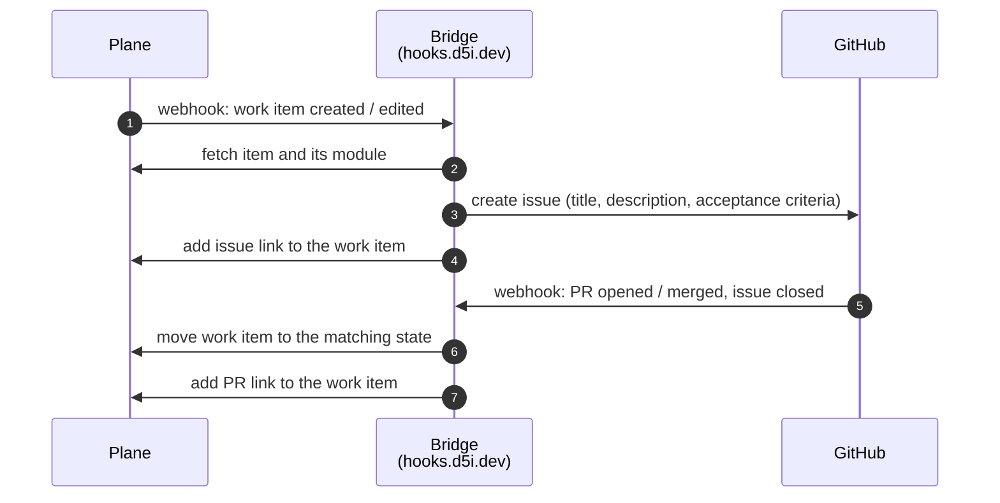

<div align="center">

# ⇄ plane-github-bridge

**Plan in Plane. Build in GitHub. Never update a board by hand.**

A small, self-hosted webhook service that links [Plane](https://plane.so) Community Edition work items to GitHub issues, built by [D5-Interactive](https://github.com/D5-Interactive).

[](https://github.com/D5-Interactive/plane-github-bridge/actions/workflows/ci.yml)
[](LICENSE)
[](https://www.python.org/)
[](https://github.com/astral-sh/uv)
[](https://fastapi.tiangolo.com/)
[](docker-compose.yml)
[](https://github.com/makeplane/plane)

[How it works](#-how-it-works) ·
[Installation](#-installation) ·
[Setup](#-setup) ·
[Team workflow](#-team-workflow) ·
[Limits](#-limits) ·
[Development](#-development)

</div>

---

## ◆ Why

Plane's built-in GitHub sync is a paid feature. This bridge gives Community
Edition the part that matters for a Scrum team:

- ▸ **Plane is where tasks are planned.** Write the task, its acceptance
  criteria and its estimate in Plane, inside a module that's mapped to a repo.
- ▸ **GitHub is where the code work happens.** The bridge creates the issue, and
  branches, commits and PRs attach to it the normal GitHub way.
- ▸ **Progress flows back on its own.** Opening, reviewing and merging PRs moves
  the work item across the sprint board.

## ◆ How it works



Both sides send webhooks **to the bridge**; the bridge is the only thing that
holds API keys for both. Every webhook is checked against its HMAC signature
before anything happens.

### State mapping

| On GitHub | Work item moves to |
|---|---|
| PR that says `Closes #N` opened as a draft | ◐ In Progress |
| PR ready for review | ◑ In Review |
| PR closed without merging, or converted to draft | ◐ In Progress |
| PR merged, or issue closed as completed | ● Done |
| Issue closed as not planned | ✕ Cancelled |
| Issue reopened | ○ Todo |

Edits to a work item's **title or description** in Plane are copied to its
issue. Edits made on the GitHub issue are **not** copied back: Plane is the
source of truth for the task itself.

## ◆ Installation

Everything runs on the Plane server, next to Plane. Clone the repo there:

```bash
cd ~
git clone https://github.com/D5-Interactive/plane-github-bridge.git
cd plane-github-bridge
```

**Requirements:** Docker with Compose v2, a running Plane Community Edition
instance, and a Cloudflare Tunnel (or any other way to give the bridge a public
HTTPS address).

## ◆ Setup

### 1. Create your config

```bash
cp .env.example .env
cp config.example.yaml config.yaml
chmod 600 .env
```

Edit `config.yaml` to map Plane projects and modules to repos:

```yaml
mappings:
  - project: SECDEV          # Plane project identifier (the prefix in SECDEV-12)
    module: DBGC             # optional: only items in this module sync
    repo: D5-Interactive/DBGC
```

A module mapping wins over a project-wide one.

### 2. Plane API token

In Plane: your avatar → **Profile settings** → **Personal access tokens**
(called API tokens in some versions) → create one → paste it into
`PLANE_API_KEY`.

> [!NOTE]
> The bridge acts as this user, so use an account that's a member of every
> mapped project.

### 3. GitHub token

Create a fine-grained token at
<https://github.com/settings/personal-access-tokens/new>:

| Setting | Value |
|---|---|
| Resource owner | `D5-Interactive` |
| Repository access | Only the repos in `config.yaml` |
| Permissions | **Issues → Read and write** (Metadata → Read is added automatically) |

Paste it into `GITHUB_TOKEN`. If the org requires approval for fine-grained
tokens, an owner approves it under **Org settings → Personal access tokens →
Pending requests**. Issues the bridge creates show as opened by the token's
owner.

Then generate the GitHub webhook secret:

```bash
openssl rand -hex 32    # paste into GITHUB_WEBHOOK_SECRET
```

### 4. Start the bridge

```bash
docker compose up -d --build
curl http://127.0.0.1:8095/health      # {"ok":true,"mappings":1}
```

### 5. Give it a public address

Cloudflare Zero Trust → **Networks → Tunnels** → your tunnel → **Add route →
Published application**:

| Field | Value |
|---|---|
| Subdomain | `hooks` |
| Domain | `d5i.dev` |
| Service URL | `http://localhost:8095` |

> [!TIP]
> The bridge only listens on `127.0.0.1`, so the tunnel is the only way in.
> Only `/plane/webhook`, `/github/webhook` and `/health` exist, and both webhooks
> reject anything without a valid signature.

### 6. Plane webhook

Plane → **Workspace settings → Webhooks → Add webhook**:

| Field | Value |
|---|---|
| URL | `https://hooks.d5i.dev/plane/webhook` |
| Events | Work items (issues) only |

Copy the secret it shows (it starts with `plane_wh_`) into
`PLANE_WEBHOOK_SECRET`, then restart:

```bash
docker compose up -d
```

### 7. GitHub org webhook

GitHub → **D5-Interactive → Settings → Webhooks → Add webhook**:

| Field | Value |
|---|---|
| Payload URL | `https://hooks.d5i.dev/github/webhook` |
| Content type | `application/json` |
| Secret | your `GITHUB_WEBHOOK_SECRET` |
| Events | **Let me select** → ✓ Issues, ✓ Pull requests |

GitHub sends a ping right away; it should show a green check.

### 8. Try it

Create a work item in a mapped module. Within a few seconds a GitHub issue
appears and its link shows on the work item.

```bash
docker compose logs -f bridge
```

> [!IMPORTANT]
> If nothing happens, set `LOG_LEVEL=DEBUG` in `.env`, restart, and try again.
> The log then shows each Plane payload exactly as received.

## ◆ Team workflow

1. **Plan in Plane.** Create the task in the right module and write the
   acceptance criteria as a checklist; it becomes a checklist on the GitHub issue.
2. **Branch from the issue.** On the GitHub issue: **Development → Create a
   branch**, so the branch is linked to the issue.
3. **Close it from the PR.** Put `Closes #<issue number>` in the PR description.
4. **Hands off the board.** Leave the Plane state alone; the bridge moves it.

## ◆ Limits

- Only work items in mapped projects/modules sync. Adding an item to a mapped
  module later also creates its issue.
- Deleting a work item doesn't delete or close its issue.
- A PR only moves a work item if it says it closes the linked issue.
- State names should be **Todo, In Progress, In Review, Done** and
  **Cancelled**. Otherwise the bridge falls back to the first state in the
  matching state group.

## ◆ Development

The project uses [uv](https://docs.astral.sh/uv/) and Python 3.14.

```bash
uv sync            # create .venv with all dependencies
uv run pytest      # run the tests
uv add <package>   # add a dependency (updates pyproject.toml and uv.lock)
```

Run it locally without Docker:

```bash
cp .env.example .env && cp config.example.yaml config.yaml   # then fill them in
set -a && . ./.env && set +a
BRIDGE_CONFIG=config.yaml BRIDGE_DB=bridge.db \
  uv run uvicorn bridge.app:create_app --factory --port 8095
```

### Project layout

```
bridge/
├── app.py       # FastAPI app: webhook endpoints + signature checks
├── sync.py      # the sync rules (Plane → GitHub, GitHub → Plane)
├── clients.py   # Plane and GitHub REST clients
├── render.py    # HTML → Markdown, closing-reference parsing, signatures
├── store.py     # SQLite: item ↔ issue links, delivery de-duplication
└── config.py    # environment settings + config.yaml mappings
tests/           # pytest suite with fake Plane and GitHub APIs
```

## ◆ License

[MIT](LICENSE) © D5i
