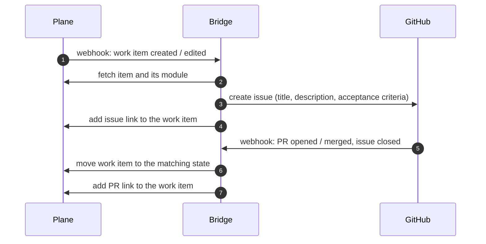

<div align="center">

# ⇄ plane-github-bridge

**Plan in Plane. Build in GitHub. Never update a board by hand.**

A small, self-hosted webhook service that links [Plane](https://plane.so) Community Edition work items to GitHub issues, built by [D5-Interactive](https://github.com/D5-Interactive).

[](https://github.com/D5-Interactive/plane-github-bridge/actions/workflows/ci.yml)
[](LICENSE)
[](https://www.python.org/)
[](https://github.com/astral-sh/uv)
[](https://fastapi.tiangolo.com/)
[](docker-compose.yml)
[](https://github.com/makeplane/plane)

[How it works](#-how-it-works) ·
[Installation](#-installation) ·
[Setup](#-setup) ·
[Linking repos](#-linking-plane-to-repos) ·
[Team workflow](#-team-workflow) ·
[Limits](#-limits) ·
[Reference](#-reference) ·
[Development](#-development)

</div>

---

## ◆ Why

Plane's built-in GitHub sync is a paid feature. This bridge gives Community
Edition the part that matters for a Scrum team:

- ▸ **Plane is where tasks are planned.** Write the task, its acceptance
  criteria and its estimate in Plane, inside a module that's mapped to a repo.
- ▸ **GitHub is where the code work happens.** The bridge creates the issue, and
  branches, commits and PRs attach to it the normal GitHub way.
- ▸ **Progress flows back on its own.** Opening, reviewing and merging PRs moves
  the work item across the sprint board.

## ◆ How it works



Both sides send webhooks **to the bridge**; the bridge is the only thing that
holds API keys for both. Every webhook is checked against its HMAC signature
before anything happens.

### State mapping

| On GitHub | Work item moves to |
|---|---|
| PR that says `Closes #N` opened as a draft | ◐ In Progress |
| PR ready for review | ◑ In Review |
| PR closed without merging, or converted to draft | ◐ In Progress |
| PR merged, or issue closed as completed | ● Done |
| Issue closed as not planned | ✕ Cancelled |
| Issue reopened | ○ Todo |

A PR counts as belonging to a work item if it says `Closes #N` for the linked
issue, or if its branch is named after the issue (`12-scan-command`).

### Activity feed

GitHub already shows branches, commits, PRs, reviews and merges on the issue.
The bridge copies that activity onto the Plane work item as comments, so the
same history is visible from either side:

| GitHub activity | Shows on the work item as |
|---|---|
| Branch created for the issue | ◆ comment + branch link |
| Commits pushed to the issue's branch, or mentioning `#N` | ◆ comment listing each commit |
| PR opened, ready for review, closed, reopened | ◆ comment + PR link |
| PR review: approved, changes requested, commented | ◆ comment |
| PR merged | ◆ comment, and the item moves to Done |

Each event is posted once, even if GitHub redelivers it.

### Edits

Edits to a work item's **title or description** in Plane are copied to its
issue. Edits made on the GitHub issue are **not** copied back: Plane is the
source of truth for the task itself.

## ◆ Installation

Everything runs on the Plane server, next to Plane. Clone the repo there:

```bash
cd ~
git clone https://github.com/D5-Interactive/plane-github-bridge.git
cd plane-github-bridge
```

**Requirements:**

- Docker with Compose v2
- A running Plane Community Edition instance on the same machine
- A GitHub organization (or personal account) that owns the repos to sync
- A way to give the bridge a public HTTPS address, such as a Cloudflare Tunnel
  or a reverse proxy

## ◆ Setup

The examples below use placeholder names. Replace them with your own:

| Placeholder | Means |
|---|---|
| `your-org` | Your GitHub organization (or username) |
| `plane.example.com` | The address your team uses to open Plane |
| `hooks.example.com` | The public address you give the bridge in step 4 |
| `your-workspace` | Your Plane workspace slug |

### 1. Create your config

```bash
cp .env.example .env
cp config.example.yaml config.yaml
chmod 600 .env
```

You fill in `.env` over the next steps. It holds the secrets: API tokens and
webhook secrets. Never commit it.

`config.yaml` can stay as it is. Repos are linked from inside Plane (see
[Linking Plane to repos](#-linking-plane-to-repos)); the file is only an
optional override for admins.

### 2. Plane API token

In Plane: your avatar → **Profile settings** → **Personal access tokens**
(called API tokens in some versions) → create one and copy it.

Open `.env` (`nano .env`) and paste it after `PLANE_API_KEY=`, with no quotes
or spaces:

```bash
PLANE_API_KEY=plane_api_0123456789abcdef
```

While you're in `.env`, fill in the three lines above it:

```bash
PLANE_BASE_URL=http://localhost:80              # Plane's port on this machine (LISTEN_HTTP_PORT in plane.env)
PLANE_PUBLIC_URL=https://plane.example.com      # the address your team opens Plane at
PLANE_WORKSPACE=your-workspace                  # the part after plane.example.com/ in your browser
```

> [!IMPORTANT]
> Copy `PLANE_WORKSPACE` from the address bar, not from the workspace's display
> name: in `https://plane.example.com/acme-team/projects/...` it's `acme-team`.
> A wrong slug makes every write fail with `403 You do not have permission`.

> [!NOTE]
> The bridge acts in Plane as whichever user owns this key: its comments, state
> changes and module edits show that user's name. Your own account works; a
> separate account just for the bridge is optional, if you'd rather the
> activity not show a person. Plane's API only lets that user edit projects it
> is an explicit **member** of (role Member or Admin). Being the workspace
> owner isn't enough. Add the account to every project whose modules you'll
> link, under **Project → Settings → Members**.

### 3. Start the bridge

GitHub comes in step 5, once the bridge has a public address. Start it now
without any GitHub settings:

```bash
docker compose up -d --build
```

The first build takes a minute or two. Give the bridge a few seconds to boot,
then check it:

```bash
sleep 5
curl http://127.0.0.1:8095/health
```

You should see:

```json
{"ok":true,"mappings":0,"plane_webhook_ready":false,"plane_api_ok":true,"github_auth":"none","github_webhook_ready":false}
```

`mappings` counts admin overrides in `config.yaml`, so `0` is normal.
`plane_api_ok` is checked once at startup: `false` comes with a
`plane_problem` message saying what's wrong (usually the workspace slug or the
API token). A setup mistake like that keeps the catch-up sync off until you fix
it and restart. Temporary trouble (Plane rate-limiting the key, answering 5xx,
or unreachable) is shown as `"plane_problem": "temporary: ..."` with
`"plane_problem_temporary": true`; the catch-up sync starts anyway and clears it
after its first pass that gets through. `plane_webhook_ready` stays `false`
until step 6, and the two `github_` fields change in step 5. The log warns about
both; that's expected for now.

If `curl` can't connect, check that the container is up and read its log:

```bash
docker compose ps                    # STATUS should be "Up", not "Restarting"
docker compose logs --tail 30 bridge
```

| Log says | Fix |
|---|---|
| `Missing required environment variable ...` | That line in `.env` is empty or misspelled |
| `IsADirectoryError` or a YAML error | `config.yaml` is missing, so Docker created a folder in its place. Run `docker compose down && rmdir config.yaml && cp config.example.yaml config.yaml`, fill it in, then start again |
| `Can't read GITHUB_APP_PRIVATE_KEY_PATH ...: Permission denied` | The key isn't readable by the container's user: `sudo chown 10001 secrets/github-app.pem` |
| `GITHUB_APP_PRIVATE_KEY_PATH ... is encrypted with a passphrase` | Use the unencrypted `.pem` GitHub generated for the app |
| `GITHUB_APP_PRIVATE_KEY_PATH ... can't be read as a private key` or `isn't an RSA key` | The file is damaged, truncated or the wrong key; download a new one from the app's settings |

### 4. Give it a public address

Plane and GitHub need to reach the bridge over HTTPS. Point a hostname such as
`hooks.example.com` at `http://localhost:8095` on this machine.

**With a Cloudflare Tunnel:** Zero Trust → **Networks → Tunnels** → your tunnel
→ **Add route → Published application**:

| Field | Value |
|---|---|
| Subdomain | `hooks` |
| Domain | `example.com` |
| Path | leave empty |
| Service URL | `http://localhost:8095` |

**With a reverse proxy** such as Caddy:

```
hooks.example.com {
    reverse_proxy 127.0.0.1:8095
}
```

Check it from a **different machine**, such as your laptop:

```bash
curl https://hooks.example.com/health
```

You should get the same `{"ok":true,...}` as in step 3.

Then tell the bridge its address, so the GitHub App gets the right webhook URL.
Add this line to `.env`:

```bash
BRIDGE_PUBLIC_URL=https://hooks.example.com
```

and recreate the container so it reads it (a plain `restart` does not reload
`.env`):

```bash
docker compose up -d --force-recreate
```

> [!TIP]
> The bridge only listens on `127.0.0.1`, so your tunnel or proxy is the only
> way in. Only `/plane/webhook`, `/github/webhook`, `/health` and the one-time
> `/setup` page exist. Both webhooks reject anything without a valid signature,
> and `/setup` needs a token from the log and closes once a GitHub App exists.

### 5. Connect GitHub

The bridge acts on GitHub as a **GitHub App**. Issues and comments then show as
`your-app[bot]` instead of a person, the app belongs to the org instead of one
member, its tokens expire after an hour, and GitHub delivers its webhooks
without a separate org webhook. Pick one:

| Option | When |
|---|---|
| **A. One-click app** (recommended) | You're an owner of `your-org`, or can ask one to click a button |
| **B. Bring your own app** | Your org already has an app it wants the bridge to use |
| **C. Personal access token** | You can't create or install apps |

Whichever you choose, the app or token asks for these permissions. Two of them
are reserved for later and unused today:

| Permission | Access | Used for |
|---|---|---|
| Issues | Read and write | Creating issues and keeping them in step with Plane |
| Pull requests | Read and write | Reading PRs linked to work items |
| Checks | Read and write | Reserved for a planned feature; unused today |
| Contents | Read | Reserved for the same planned feature; unused today |
| Metadata | Read | Reading a repo's name and description (always granted) |

Checks and Contents aren't used yet. They're requested now so that when the
feature ships, the app doesn't have to be re-approved by an org owner. If you'd
rather grant only what's used today, leave them off; you'll be asked to accept
the new permissions then.

And these webhook events: **Issues, Pull request, Pull request review, Push,
Create** (branch or tag creation). The bridge never asks for Administration, so
it can't rename, delete or reconfigure a repo.

#### A. One-click app

1. Find the setup link in the bridge's log:

   ```bash
   docker compose logs bridge | grep setup
   ```

   ```text
   WARNING GitHub App not set up. To create one in a click, open: https://hooks.example.com/setup?token=...
   ```

   The token changes every time the container starts and stops working once an
   app exists. Treat the link as a secret until setup is complete: anyone who
   has it can attach their own app to the bridge.

2. Open the link. Check the organization (filled in from
   `GITHUB_ALLOWED_OWNERS` if set) and the app name, which must be unique on
   all of GitHub. If you change either, click **Update**.
3. Click **Create the app on GitHub**. GitHub shows the app with every setting
   already filled in; confirm with **Create GitHub App for your-org**.
4. GitHub sends you back to the bridge, which saves the app's ID, private key
   and webhook secret (in `/data/github-app.json`, readable only by the
   bridge) and starts using them at once. You land on the app's **Install**
   page.
5. Install it on `your-org`. Choose **All repositories** so linking a new repo
   is done entirely in Plane, or **Only select repositories** if you'd rather
   add each repo to the app as you link it.

`curl http://127.0.0.1:8095/health` should now show `"github_auth":"app"`, the
app's name in `github_app`, `"github_webhook_ready":true`, and, if you set
`GITHUB_ALLOWED_OWNERS`, your org under `github_app_installed_on` with
`github_app_missing_on` and `github_app_unknown_on` empty. The app's own webhook
is already set up: skip to step 6.

These three lists come from what the bridge last heard from GitHub, so they
never claim more than it knows: an account whose answer has expired, or whose
lookup failed, is listed under `github_app_unknown_on` until the next check,
which runs about every minute.

> [!NOTE]
> Creating an app on an organization takes an org owner or an **app manager**
> (Org settings → Developer settings → GitHub Apps → Management). Without that
> role, GitHub shows a 404 after step 3. Ask an owner to open the setup link,
> or leave the organization field empty to make the app on your own account,
> then **transfer** it to the org from the app's settings.

#### B. Bring your own app

Use an existing app (Org settings → **Developer settings → GitHub Apps**) with
the permissions and events above, and its webhook pointed at
`https://hooks.example.com/github/webhook` with content type
`application/json` and a webhook secret.

1. From the app's page, note the **App ID** and generate a **private key**
   (a `.pem` file). Copy the key to the server into a `secrets` folder next to
   `.env`, and let the container's user read it:

   ```bash
   mkdir -p secrets
   mv ~/your-app.private-key.pem secrets/github-app.pem
   chmod 600 secrets/github-app.pem
   sudo chown 10001 secrets/github-app.pem    # the container's user
   ```

   `docker-compose.yml` already mounts `./secrets` read-only at
   `/app/secrets`, and git ignores the folder. If the bridge ran before, Docker
   may have created an empty `secrets` folder owned by root; take it over
   first with `sudo chown $USER secrets`.

2. Add to `.env`:

   ```bash
   GITHUB_APP_ID=123456
   GITHUB_APP_PRIVATE_KEY_PATH=/app/secrets/github-app.pem    # the default; can be left out
   GITHUB_WEBHOOK_SECRET=<the app's webhook secret>
   GITHUB_ALLOWED_OWNERS=your-org
   ```

3. Install the app on `your-org` (**All repositories**, or the repos you'll
   link), then recreate the container:

   ```bash
   docker compose up -d --force-recreate
   sleep 5 && curl http://127.0.0.1:8095/health
   ```

   Look for `"github_auth":"app"`, no `github_problem`, and (with
   `GITHUB_ALLOWED_OWNERS` set) empty `github_app_missing_on` and
   `github_app_unknown_on` lists.

**Moving from a token and org webhook to your own app?**

1. Give the app the same webhook secret as the org webhook. With your own app
   the bridge has one `GITHUB_WEBHOOK_SECRET`, so both webhooks must use it;
   whichever doesn't match gets `401`.
2. After step 3, turn on the app's webhook (**Active**) first. Delete the org
   webhook a minute later. Events in that overlap arrive twice, which is
   harmless: each activity comment is posted once and state moves don't
   repeat. A gap, on the other hand, loses events.
3. Check `/health`: `github_app_missing_on` and `github_app_unknown_on` must
   both be present and empty, or repos of the accounts listed there still
   depend on the token. A missing field means the app can't be checked right
   now (see `github_problem`): don't revoke the token yet.
4. Once activity shows up as the app's bot, remove `GITHUB_TOKEN` from `.env`,
   recreate the container, and revoke the token.

An app set in `.env` takes priority over one made with `/setup`.

> [!TIP]
> Webhooks can come through a relay, such as a hub that receives an app's
> deliveries and fans them out to several services, as long as it forwards
> the raw body and the `X-Hub-Signature-256` and `X-GitHub-Event` headers
> unchanged. The bridge checks the signature against the exact bytes it
> receives, so a relay that re-encodes the JSON breaks it.

#### C. Personal access token

Fine-grained tokens are created from a **user account**, then pointed at the
org. Issues and comments show as that account: your own, or a separate account
if you'd rather they didn't show your name.

1. Create the token at <https://github.com/settings/personal-access-tokens/new>
   (your avatar → **Settings → Developer settings → Personal access tokens →
   Fine-grained tokens**):

   | Setting | Value |
   |---|---|
   | Resource owner | `your-org` (not your username) |
   | Repository access | **All repositories**, or only the repos you'll link |
   | Permissions | **Issues → Read and write** (Metadata → Read is added automatically) |

   Issues is all a token needs: commits, branches, PRs and reviews reach the
   bridge inside webhook payloads. With **Only select
   repositories**, each new repo also has to be added to the token before its
   issues can be created.

   > [!NOTE]
   > If `your-org` doesn't appear under Resource owner, an org owner has to
   > allow fine-grained tokens first: **Org settings → Personal access tokens →
   > Settings**. If the org requires approval, the owner then approves the
   > token under **Pending requests**.

2. Make up a webhook secret:

   ```bash
   openssl rand -hex 32
   ```

3. Put both in `.env`, along with your org name, and recreate the container:

   ```bash
   GITHUB_TOKEN=github_pat_0123456789abcdef
   GITHUB_WEBHOOK_SECRET=<the output of openssl rand -hex 32>
   GITHUB_ALLOWED_OWNERS=your-org
   ```

   ```bash
   docker compose up -d --force-recreate
   ```

4. Add an org webhook, since a token gets no webhooks of its own. One webhook
   on the organization covers every repo, including ones you add later. If you
   aren't an org owner, add the same webhook to each linked repo under
   **Repo → Settings → Webhooks** instead.

   On GitHub, open **your-org → Settings → Webhooks → Add webhook** and fill in:

   | Field | Value |
   |---|---|
   | Payload URL | `https://hooks.example.com/github/webhook` |
   | Content type | `application/json` (the default is form-encoded; change it) |
   | Secret | the `GITHUB_WEBHOOK_SECRET` value from `.env` |
   | SSL verification | Enable SSL verification (the default) |

   Under **Which events would you like to trigger this webhook?**, choose **Let
   me select individual events** and make sure exactly these five are ticked
   (**Pushes** is on by default):

   - ✓ Branch or tag creation
   - ✓ Issues
   - ✓ Pull requests
   - ✓ Pull request reviews
   - ✓ Pushes

   Keep **Active** ticked and click **Add webhook**.

5. Open the webhook again and select the **Recent Deliveries** tab. GitHub sends
   a ping as soon as the webhook is created; it should show a green ✓.

The token keeps working alongside an app. The bridge falls back to it for an
account the app isn't installed on, for a repo left out of a **Only select
repositories** install (the call is retried with the token), for a public repo
outside the install that the app can read but not write to (GitHub answers
"Resource not accessible by integration"; the write is retried with the token),
and while the app is failing (`/health` shows the reason, with GitHub's own
message, as `github_problem`):

- **The whole app** (a key that can't sign or that GitHub rejects, a skewed
  clock, GitHub errors or unreachable): the bridge uses the token for about 45
  seconds before calling GitHub as the app again, so every call doesn't pay for
  the failure. A GitHub rate limit pauses the app for as long as GitHub asks,
  up to a minute. Installation tokens it already has keep working meanwhile.
- **One account** (GitHub refuses the app there, for example "This installation
  has been suspended"): only that account uses the token, for 5 minutes or
  until an installation event for it arrives. Other accounts keep the app.

The startup check of the app runs in the background, so GitHub being slow or
down never delays startup, and a failed check is retried every few minutes.
Without `GITHUB_TOKEN`, a request the app can't sign right now isn't sent at
all; the catch-up sync skips that repo for the rest of the pass (one log line,
no Plane reads for its items) and tries again next pass instead of parking it.
When an installation event arrives (the app installed, or repos added to it),
items parked for that account's repos are tried again on the next pass.

To move from a token to an app later, do option A, check that
`github_app_missing_on` and `github_app_unknown_on` in `/health` are empty,
then delete the org webhook. With an app made by `/setup`, both its secret and
`GITHUB_WEBHOOK_SECRET` are accepted in the meantime, so nothing is missed.
Once the org webhook is gone, remove `GITHUB_WEBHOOK_SECRET` from `.env` and
recreate the container: as long as it's set, deliveries signed with it are
still accepted.

| Ping shows (any option) | Meaning |
|---|---|
| ✓ 202 | Working (202 means "accepted") |
| ✕ 401 | The secret doesn't match the bridge's. Paste it again, or make a new one in both places |
| ✕ 503 | The bridge has no GitHub webhook secret yet |
| ✕ couldn't connect / 502 | GitHub can't reach the bridge. Recheck step 4 |

### 6. Plane webhook

1. In Plane, open **Workspace settings → Webhooks → Add webhook**.
2. Fill in:

   | Field | Value |
   |---|---|
   | URL | `https://hooks.example.com/plane/webhook` |
   | Events | **Work items** (called Issues in some versions) and **Modules**. Projects, cycles and comments aren't needed |

3. Save. Plane shows a secret that starts with `plane_wh_`. Copy it; Plane may
   not show it again.
4. On the server, open `.env` and paste it in:

   ```bash
   nano .env
   ```

   ```bash
   PLANE_WEBHOOK_SECRET=plane_wh_0123456789abcdef
   ```

5. Recreate the container so it reads the new value:

   ```bash
   docker compose up -d --force-recreate
   sleep 5 && curl http://127.0.0.1:8095/health
   ```

   `plane_webhook_ready` should now be `true`.

### 7. Try it


Link a module to a repo as described in
[Linking Plane to repos](#-linking-plane-to-repos), then create a work item in
that module. Within a few seconds a GitHub issue
appears and its link shows on the work item.

```bash
docker compose logs -f bridge
```

> [!IMPORTANT]
> If nothing happens, set `LOG_LEVEL=DEBUG` in `.env`, restart, and try again.
> The log then shows each Plane payload exactly as received.

## ◆ Linking Plane to repos

Only work items in a **linked module** go to GitHub. Everything else stays in
Plane, which keeps admin, planning and other organizational work off GitHub:

| Work item is in | Goes to GitHub? |
|---|---|
| A module whose description has a GitHub repo link | ✓ Yes, to that repo |
| A module with no repo link | ✕ No, stays in Plane |
| No module at all | ✕ No, stays in Plane |

Anyone who can edit a module in Plane can link it. No server access is needed.

1. In Plane, open the project → **Modules** → the module (or create one).
2. Paste the repo's GitHub URL **anywhere** in the module's description, for
   example `code is at https://github.com/your-org/auth-service, ask Sam`.
3. Save. Within a few seconds the bridge tidies the module, which is also how
   you can tell the link worked:
   - **Name** becomes the repo's name, e.g. `auth-service`.
   - **Links** gets the repo, titled `GitHub: your-org/auth-service` (see the
     note below on Plane versions).
   - **Start date** becomes the day the repo was created on GitHub.
   - **Description** becomes the repo link and the repo's GitHub description:

     ```
     https://github.com/your-org/auth-service
     Login, sessions and token refresh for the web app.
     ```

   If the repo has no description on GitHub, only the link is kept. To change
   that second line, edit the repo's **About** on GitHub, then save the module
   again.
4. That's it. Work items created in that module get an issue within seconds.
   Existing items moved into the module get theirs within about two minutes
   (see [Catch-up sync](#catch-up-sync)).

> [!NOTE]
> The tidy-up replaces everything else in the module's name and description, so
> keep notes in Plane Pages or the work items instead. If another module in the
> project already has the repo's name, only the description is updated. Nothing
> changes if the bridge's GitHub app or token can't see the repo or its owner isn't in
> `GITHUB_ALLOWED_OWNERS`.

Changes take effect within a minute. To unlink a module, remove the URL from
its description; issues that already exist stay linked.

> [!NOTE]
> Admins can also pin module mappings in `config.yaml`, which take priority over
> links set in Plane. See the comments in `config.example.yaml`. Mappings there
> match the module by name, so update them if the module is renamed.

## ◆ Team workflow

1. **Plan in Plane.** Create the task in a linked module and write the
   acceptance criteria as a checklist; it becomes a checklist on the GitHub issue.
2. **Branch from the issue.** On the GitHub issue: **Development → Create a
   branch**. GitHub names it like `12-scan-command`, which links the branch, its
   commits and its PR to the work item automatically.
3. **Close it from the PR.** Put `Closes #<issue number>` in the PR description.
   Commits on other branches show up too if their message mentions `#12`.
4. **Hands off the board.** Leave the Plane state alone; the bridge moves it.

## ◆ Limits

- Only work items in linked modules sync. Work items in unlinked modules or in
  no module stay in Plane. Moving an item into a linked module later creates its
  issue at the next catch-up sync, within about two minutes.
- Deleting a work item doesn't delete or close its issue.
- A PR only moves a work item if it says it closes the linked issue or its
  branch is named after it.
- Commit and review comments only reach Plane for issues the bridge created.
- State names should be **Todo, In Progress, In Review, Done** and
  **Cancelled**. Otherwise the bridge falls back to the first state in the
  matching state group.

## ◆ Reference

The exact rules the bridge follows. Everything here matches the code in
`bridge/`; if you change a rule, update this section with it.

### Events it listens to

| Source | Event | What the bridge does |
|---|---|---|
| Plane | Work item created / updated | Creates the GitHub issue if the item is in a linked module and has none yet; otherwise pushes title/description edits to its issue |
| Plane | Work item deleted | Nothing. The issue stays |
| Plane | Module created / updated | Tidies the module if its description links a repo |
| GitHub | `issues` closed / reopened | Moves the work item's state |
| GitHub | `pull_request` | Moves the state, adds the PR link and an activity comment |
| GitHub | `pull_request_review` submitted | Activity comment |
| GitHub | `push` | Activity comment listing the commits |
| GitHub | `create` (branch) | Activity comment and branch link |
| GitHub | `ping` | Replies so GitHub shows a green ✓ |
| Either | Anything else | Ignored and logged |

Every request is checked against its HMAC-SHA256 signature first:
`X-Plane-Signature` with `PLANE_WEBHOOK_SECRET`, `X-Hub-Signature-256` with
the GitHub App's webhook secret or `GITHUB_WEBHOOK_SECRET` (either is accepted,
so an org webhook keeps working while you move to an app). A bad or missing signature gets `401` and nothing else
happens. A good one gets `202 Accepted` at once and is processed in the
background, so Plane and GitHub never wait on the bridge.

### Catch-up sync

Plane sends **no webhook** when an existing work item is added to a module.
Without help, an item created first and then dragged into a linked module would
never reach GitHub. So every `BRIDGE_SYNC_INTERVAL` seconds (default 120, and
once at startup) the bridge:

1. adds any issue links that never reached Plane (up to 10 per pass, least
   recently tried first; see below),
2. lists the workspace's projects and their modules,
3. picks the modules linked to a repo (description URL or `config.yaml`) whose
   owner is allowed; projects with none are skipped without listing anything,
4. lists each linked module's items once, and creates an issue for every item
   that doesn't have one yet.

Items that already have an issue are skipped, so it never creates duplicates.
Projects the token's account can't read are skipped quietly. A pass costs one
Plane API call for the project list, one per project for its modules, one per
linked module, and a few per new item, so a quiet pass stays cheap however many
items your modules hold. Set `BRIDGE_SYNC_INTERVAL=0` to turn it off.

When something goes wrong:

| What happens | What the pass does |
|---|---|
| One item fails | Logs one line with the project and item ID and the reason, then carries on with the rest |
| GitHub refuses the item for a lasting reason (repo gone, Issues disabled, no access: 403, 404, 410, 422) | Parks it for that repo and skips it for 6 hours, logging one line per repo. Editing the item in Plane, linking its module to a different repo, or restarting the bridge retries it at once |
| Any other error (Plane errors other than 429 and 401, GitHub 5xx, timeouts, network) | Retries the item next pass |
| Plane or GitHub rate-limits the bridge (429, or GitHub's secondary rate limit), anywhere in the pass | Stops the pass at once instead of hammering the API; the next pass picks up where it left off |
| Plane or GitHub rejects the key or token (401) | Stops the pass with one log line; nothing is parked, so fixing the credential and waiting a pass is enough |
| The issue was created but adding its link to the Plane item failed | The link is recorded as missing and added by a later pass, so the issue is never created twice. If adding it answers 404, the bridge asks Plane for the work item itself, and stops trying only if Plane says it doesn't exist. A 404 page from a proxy (while Plane restarts) counts as temporary |
| An item is listed in a linked module but Plane says it doesn't exist | Parks it like a lasting refusal (6 hours, or until it's edited or the bridge restarts), so it isn't read every pass |

The log gets one summary line per pass, and only when the pass did something.

The catch-up sync only creates **missing issues** and adds **missing issue
links**. It doesn't replay other work: a title or description edit, or a state
change from GitHub, whose webhook failed (for example because Plane still
answered 429 after the retries) is lost, and the log says so. Editing the item
again sends the edit again.

### Deciding whether a work item goes to GitHub

When a work item without an issue is created or updated, the bridge looks for a
repo in this order and stops at the first match:

1. **`config.yaml`** mappings for the item's project, if the item is in that
   mapping's module.
2. **Module descriptions:** each module in the project whose description holds a
   `https://github.com/owner/repo` URL, if the item is in that module.
3. **No match:** the item stays in Plane. The log says
   `kept in Plane: item isn't in a module linked to a repo`.

Then two last checks: the repo's owner must be in `GITHUB_ALLOWED_OWNERS` (when
that's set), and the bridge's GitHub app or token must be able to create issues there.

Details:

- The URL can be anywhere in the description, in plain text or as a link.
  `.git` endings and trailing paths like `/issues/3` are ignored. The first
  GitHub repo URL wins.
- Project descriptions are **not** read. An item in no module never syncs.
- An item in several linked modules goes to the first one Plane lists.
- Module and project details are cached for 60 seconds, so a new link takes up
  to a minute to apply.
- An item gets at most one issue, ever. Moving it to another module afterwards
  doesn't create a second issue or move the existing one.

### What the GitHub issue contains

| Issue field | Comes from |
|---|---|
| Title | The work item's name |
| Body | The work item's description, converted to GitHub Markdown |
| Footer | `Synced from Plane work item [ALL-12](link). Plan, estimate and edit the task in Plane; do the code work here.` |

Plane checklists become GitHub task lists: an unchecked item is `- [ ]`,
a checked one `- [x]`. Headings, lists, bold, links and code carry over.

The work item gets a link back, titled `GitHub owner/repo#12`.

### Edits after the issue exists

- **Plane → GitHub:** when the work item's **title or description** changes, the
  bridge rewrites the issue's title and body from the work item. Other fields
  (assignees, labels, priority, estimate, dates) aren't copied.
- **GitHub → Plane:** edits to the issue's title or body are not copied back,
  and the next Plane edit overwrites them. Treat Plane as the source of truth
  for the task's wording.

### How PRs, branches and commits find their work item

GitHub activity is matched to a work item through the issue the bridge created.
Activity on any other issue is ignored.

| Activity | Matched when |
|---|---|
| Pull request | Its title or body says `close`, `closes`, `closed`, `fix`, `fixes`, `fixed`, `resolve`, `resolves` or `resolved` followed by `#12` (or `owner/repo#12`), **or** its branch is named after the issue |
| Branch | Its name starts with the issue number: `12-scan-command`, `12_scan`, `feature/12-scan` |
| Commit | It's pushed to a branch named after the issue, **or** its message mentions `#12` anywhere |
| Review | It's on a PR that matches, by the PR rules above |

### State changes

| On GitHub | Work item moves to |
|---|---|
| PR opened as a draft, converted to draft, or closed without merging | In Progress |
| PR opened (not draft), marked ready, reopened, edited, or new commits pushed to it | In Review |
| PR merged | Done |
| Issue closed as completed | Done |
| Issue closed as not planned | Cancelled |
| Issue reopened | Todo |

The bridge finds each target state by **name** first (`Todo`, `In Progress`,
`In Review`, `Done`, `Cancelled`, case-insensitive) and otherwise takes the
first state in the matching Plane state group (unstarted, started, completed,
cancelled). With no `In Review` state, PRs in review land in the first
"started" state. If the work item is already in the target state, nothing is
sent.

### Activity comments

Comments are posted by the Plane account that owns `PLANE_API_KEY`, and start
with `◆ GitHub ·`.

| Activity | Comment | Also adds a link |
|---|---|---|
| Branch created | `branch 12-scan created by zep` | The branch |
| Push | `3 commits pushed to 12-scan by zep`, then each commit's short hash (linked) and first line, up to 10, then "…and N more" | ✕ |
| PR opened / ready / converted / closed / reopened / merged | `PR repo#5 "Add scan" merged into main by zep` | The PR, the first time it's seen |
| Review | `lead ✓ approved PR repo#5`, `✕ requested changes on`, or `commented on` (empty review comments are skipped) | ✕ |

Each one is posted once. The bridge records what it has posted for each work
item (each commit, branch, review and PR event), so a commit is listed only the
first time it's pushed, and a redelivered GitHub event posts nothing new. Commit messages and
names are HTML-escaped, so nothing in a commit can inject markup into Plane.

### Module tidy-up

Runs when Plane reports a module was created or updated, and whenever a work
item is synced through a module. If the module's description links a repo that
the bridge can see and the owner is allowed:

1. **Name** → the repo's name (`auth-service`). If another module in the
   project already has that name, Plane refuses the rename and the rest still
   happens.
2. **Description** → the repo link, then the repo's GitHub description (its
   **About** text). No About text, just the link.

3. **Start date** → the day the repo was created on GitHub (its `created_at`,
   in UTC). This is the repo's creation date, not its first commit, which
   would cost an extra API call per link. For a repo created on GitHub
   they're normally the same day; for one pushed from older local history,
   the first commit can be earlier. Plane refuses a start date after the
   module's target date; then the start date is left as it was.
4. **Links** → the repo URL, titled `GitHub: owner/repo`, added once. Plane's
   public API doesn't document module links, so this is best effort: if your
   Plane version doesn't accept it, the bridge logs
   `this Plane's API has no module links endpoint` once, stops trying, and the
   renamed module and its description serve as the confirmation instead.

The comparison is on the visible text, so the `module.updated` webhook caused by
the bridge's own edit changes nothing and can't loop. Anything else that was in
the description is replaced.

### What's stored

A SQLite database at `/data/bridge.db`, in the `bridge-data` Docker volume:

| Table | Holds |
|---|---|
| `links` | Work item ↔ GitHub issue pairs, and whether the issue link reached the Plane item. This is what makes "one issue per item" work |
| `seen_events` | Plane event IDs, to drop Plane's retries |
| `posted` | Which commits, branches, reviews and PR events were already posted per item |
| `pr_links` | Which PR links were already added per item |
| `sync_failures` | Items GitHub refused for a lasting reason, with the repo and when, so the catch-up sync waits before retrying them. Cleared at every startup |

If the GitHub App was made with `/setup`, its ID, private key and webhook secret
are in `/data/github-app.json` in the same volume, readable only by the
container's user. Deleting that file and recreating the container brings
`/setup` back.

> [!WARNING]
> Deleting the volume (`docker compose down -v`) forgets every link. The next
> edit to an already-synced work item would then create a **second** GitHub
> issue. Back the volume up with the rest of your server.

#### Upgrading and rolling back

Upgrading migrates the database by itself: the `links` table gains the
`plane_linked` and `last_link_attempt` columns, and `sync_failures` is created
or rebuilt. Rows that existed before the upgrade count as linked in Plane.

**Rolling back** to a version from before these columns existed is **not
safe** as it is: the older code saves links with five values, the table now has
seven columns, and every save fails *after* the GitHub issue was created, so
each event makes another duplicate issue. If you must roll back, run these steps
from a checkout of **this** version, before switching, so the image is the one
that knows the new columns:

1. **Let pending link repairs finish.** Dropping the columns makes every row
   look linked, so a link still waiting to be added would never be. This
   prints how many are waiting; go on when it says `0`:

   ```bash
   docker compose run --rm bridge python -c \
     "import sqlite3; print(sqlite3.connect('/data/bridge.db').execute('SELECT COUNT(*) FROM links WHERE plane_linked = 0').fetchone()[0])"
   ```

2. **Stop the bridge, back up the database and remove the new columns.** This
   uses the bridge's own image (its Python includes SQLite), so it needs no
   internet access. The backup is `bridge.db.bak` in the same volume:

   ```bash
   docker compose stop bridge
   docker compose run --rm bridge python -c "
   import shutil, sqlite3
   shutil.copy('/data/bridge.db', '/data/bridge.db.bak')
   db = sqlite3.connect('/data/bridge.db')
   db.execute('ALTER TABLE links DROP COLUMN last_link_attempt')
   db.execute('ALTER TABLE links DROP COLUMN plane_linked')
   db.execute('DROP TABLE IF EXISTS sync_failures')
   db.commit()"
   ```

3. Check out the older version and start it as usual.

**Re-checking issue links.** Links lost before this version (when a pass died
between creating the issue and adding its link) aren't known to the database.
To have the bridge check every link once, set `BRIDGE_RECHECK_LINKS=1` in
`.env` and recreate the container. At startup it marks every link as
"maybe missing", and the catch-up sync re-adds them 10 per pass. Plane refuses
a link URL an item already has, so items that kept their link are left as they
are. When the log stops showing `sync: repaired ...` lines, remove the setting
and recreate the container again, or the next restart re-checks everything.

### Security model

- The bridge listens on `127.0.0.1:8095` only; a tunnel or reverse proxy is the
  only way in.
- Both webhooks need a valid HMAC signature. An unset `PLANE_WEBHOOK_SECRET`
  rejects every Plane webhook with `503` rather than accepting unsigned ones.
- On GitHub the bridge has Issues, Pull requests and Checks (read and write)
  and Contents and Metadata (read only); Checks and Contents are reserved for a
  planned feature and unused today. It can't change code, and has no
  Administration access, so it can't rename, delete or reconfigure a repo. A
  personal access token needs only Issues.
- GitHub App installation tokens are minted from the app's private key, cached
  in memory, and replaced five minutes before their one-hour expiry. The
  private key never leaves the server.
- `/setup` only answers while no app is configured, and only with the one-time
  token printed in the log. The state GitHub sends back is checked and
  single-use, and only one callback runs at a time, so nobody else can attach
  their own app to your bridge. It also refuses to run while
  `BRIDGE_PUBLIC_URL` is still the `example.com` placeholder.
- The setup token is in the link's query string, so it can appear in your
  proxy or tunnel's access logs: treat the link as a secret until setup is
  complete. It changes on every restart and stops working once an app exists.
  The bridge keeps `/setup` query strings (the token and the one-time code
  GitHub sends back) out of its access log, and out of its request log unless
  `LOG_LEVEL=DEBUG`. The setup
  pages tell browsers not to send their address to other sites
  (`Referrer-Policy: no-referrer`).
- `GITHUB_ALLOWED_OWNERS` stops anyone in Plane from pointing a module at a repo
  outside your org.
- The container runs as an unprivileged user.

### Reading the log

`docker compose logs -f bridge` prints one line per event:

| Log line | Meaning |
|---|---|
| `plane: created owner/repo#12` | New issue made for a work item |
| `plane: kept in Plane: ...` | The item isn't in a linked module; working as intended |
| `sync: created owner/repo#12, ...` | The catch-up sync found items added to linked modules and made their issues |
| `sync: repaired 2 Plane link(s)` | Issue links that didn't reach Plane earlier were added |
| `sync: API item ... failed, retrying next pass (...)` | One item hit a temporary error; the rest of the pass went on |
| `sync: owner/repo refused items from API (...); parked for 6h ...` | GitHub refused items for a lasting reason, such as Issues being disabled or the token lacking access. Fix it and edit the item, or restart the bridge |
| `sync: stopped early, will resume next pass (... answered 429 ...)` | Plane or GitHub rate-limited the bridge; the catch-up sync loses nothing |
| `sync: stopped, a key or token was rejected (...)` | `GITHUB_TOKEN` or `PLANE_API_KEY` is wrong or expired; the sync tries again every pass |
| `sync: work item ... is gone from Plane; not adding the link ...` | The item was deleted after its issue was made; harmless |
| `sync: cleared 3 parked item(s); they'll be tried again` | Startup: items parked before the restart get a fresh try |
| `BRIDGE_RECHECK_LINKS is set: re-checking ...` | The one-off link re-check is on; remove the setting when it's done |
| `catch-up sync of linked modules every 120s` | Startup message; the sync is on |
| `plane: updated owner/repo#12` | Title/description edit pushed to the issue |
| `plane: module tidied for owner/repo` | Module renamed, description rewritten and/or repo link added |
| `this Plane's API has no module links endpoint` | Your Plane can't take module links from the API; name and description still update |
| `plane: unchanged: module already tidy` | The bridge's own edit coming back; harmless |
| `plane: ignored: token can't see owner/repo` | Install the GitHub App on that repo (or add it to the token), or fix the URL |
| `plane: ignored: ... GITHUB_ALLOWED_OWNERS` | The module links a repo outside the allowed owners |
| `plane: ignored: duplicate delivery` | Plane retried an event already handled |
| `github:push: ignored: commits don't touch a linked issue` | A push unrelated to any synced work item |
| `github:pull_request: moved to review` | State changed on the work item |
| `... failed` followed by a traceback | Something errored; the event is skipped and the bridge keeps running |
| `WARNING PLANE_WEBHOOK_SECRET is not set` | Expected until setup step 6 is done |
| `GitHub App not set up ... open: .../setup?token=...` | No app yet: the one-time setup link (setup step 5A) |
| `acting on GitHub as the app ...` | Startup message; the GitHub App is in use |
| `GITHUB APP PROBLEM: GitHub rejected the app's private key` | Wrong key for that app ID, or the server's clock is off |
| `GitHub App isn't installed on owner` | Install the app on that account; until then the bridge uses `GITHUB_TOKEN` there if set. Checked again every 10 minutes |
| `GitHub App is not installed on: owner, ...` | Startup check of `GITHUB_ALLOWED_OWNERS`; `/health` shows the live state as `github_app_missing_on` (and `github_app_unknown_on` for accounts it couldn't check) |
| `GITHUB APP PROBLEM: the app's private key can't be used to sign requests` | The saved or configured key is damaged; calls use `GITHUB_TOKEN` meanwhile. Replace the key |
| `GITHUB APP PROBLEM: GitHub answered 403 ("This installation has been suspended") ...` | GitHub refuses the app on that account; only that account falls back to `GITHUB_TOKEN`. Unsuspend or reinstall the app there |
| `GITHUB APP PROBLEM: ... isn't JSON ...` | Something between the bridge and GitHub (a proxy) answered instead of GitHub |
| `sync: skipping owner/repo for this pass: not sending ...` | No app token for that repo right now and no `GITHUB_TOKEN` to fall back to; nothing was sent and the repo's items aren't read from Plane this pass. They aren't parked: they sync once the app is installed there or a token is set. See `github_problem` in `/health` |
| `sync: GitHub App installation changed on owner; cleared N parked item(s)` | Items parked for that account's repos are tried again next pass |
| `GITHUB APP PROBLEM: ...` (any other reason) | The app can't be used right now; calls fall back to `GITHUB_TOKEN` if set. Shown live in `/health` as `github_problem` |
| `GitHub App working again` | The problem above cleared itself |
| `GitHub returned no webhook secret for the new app` | Copy the app's webhook secret into `GITHUB_WEBHOOK_SECRET` and recreate the container |
| `Can't read the saved GitHub App in /data/github-app.json` | The file `/setup` saved is damaged. Delete it and recreate the container to run `/setup` again |
| `PLANE SETUP PROBLEM: Plane refused workspace '...'` | `PLANE_WORKSPACE` doesn't match the slug in your Plane URL |
| `Plane isn't answering normally at startup (...); starting the catch-up sync anyway` | Plane was rate-limiting, down or unreachable at startup; the sync retries every pass |
| `Plane's API is answering again` | The temporary startup problem cleared; `/health` shows `plane_api_ok: true` again |
| `sync: API item ... is listed in a module but Plane says it doesn't exist; parked for 6h` | A deleted work item is still in a module's list; harmless |
| `... -> 403: You do not have permission to perform this action.` | The token's account isn't a member of that project, or the slug is wrong |
| `Plane rate limit: GET /... answered 429; waiting 10s (retry 1 of 3)` | Plane's per-key limit was hit; the bridge waits and retries. If it's frequent, lower `PLANE_RATE_LIMIT` |
| `GitHub rate limit: POST /repos/... answered 403; waiting 60s and retrying once` | GitHub's secondary rate limit, usually from creating many issues quickly; harmless |

Set `LOG_LEVEL=DEBUG` in `.env` and recreate the container to also print each
Plane payload as received.

### API usage

Per Plane event the bridge makes a handful of Plane API calls (the work item,
plus the project and module list when they're not cached) and at most one or two
GitHub calls. With a GitHub App, minting an installation token adds one call
per account per hour.

**Plane's rate limit.** Plane limits each API key to a number of requests per
minute (60 by default) and answers `429 RATE_LIMIT_EXCEEDED` above it. The
bridge keeps itself under the limit and recovers when it hits it anyway:

- **Pacing.** All Plane calls are spaced evenly so they stay under
  `PLANE_RATE_LIMIT` requests per minute (default `50`). Set it a little below
  your Plane's limit, or to `0` to turn pacing off.
- **Backoff.** A request answered `429` waits as long as Plane's `Retry-After`
  (or `X-RateLimit-Reset`) header says, at most 60 seconds, then is sent again,
  up to 3 times. Every other request waits out the same window, so one 429
  doesn't turn into many. If Plane asks for more than 60 seconds, the request
  that got the 429 fails at once instead of sleeping, and every other Plane
  call is held for 60 seconds. When a request gives up after its last retry,
  the others are still held for its window. A failed request is
  logged; the catch-up sync retries missing issues and links on its next pass,
  but a webhook's edit or state change isn't replayed (edit the item again).

**At startup** the bridge checks Plane once, with no retries, so a
rate-limited Plane can't hold up startup. The GitHub App check runs in the
background and doesn't hold it up at all. A 429, a 5xx or an unreachable Plane
is logged as a warning and shown as temporary in `/health`, and the catch-up
sync starts anyway; a wrong key or workspace slug keeps it off.

**GitHub's rate limits.** A `429`, or a `403` that is GitHub's secondary rate
limit, is retried once after the wait GitHub asks for, if that's 60 seconds or
less; a longer wait (such as the hourly limit) fails at once. Ordinary `403` and
`404` answers aren't retried.

**Error logs.** A failed request is logged as its method, path and status only.
Response bodies can echo work item content, so they're only logged with
`LOG_LEVEL=DEBUG`.

## ◆ Development

The project uses [uv](https://docs.astral.sh/uv/) and Python 3.14.

```bash
uv sync            # create .venv with all dependencies
uv run pytest      # run the tests
uv add <package>   # add a dependency (updates pyproject.toml and uv.lock)
```

Run it locally without Docker:

```bash
cp .env.example .env && cp config.example.yaml config.yaml   # then fill them in
set -a && . ./.env && set +a
BRIDGE_CONFIG=config.yaml BRIDGE_DB=bridge.db \
  uv run uvicorn bridge.app:create_app --factory --port 8095
```

### Project layout

```
bridge/
├── app.py       # FastAPI app: webhook endpoints + signature checks
├── sync.py      # the sync rules (Plane → GitHub, GitHub → Plane)
├── clients.py   # Plane and GitHub REST clients
├── github_auth.py # GitHub App JWTs, installation tokens, token fallback
├── setup.py     # one-click GitHub App creation (manifest flow)
├── render.py    # HTML → Markdown, closing-reference parsing, signatures
├── store.py     # SQLite: item ↔ issue links, delivery de-duplication
└── config.py    # environment settings + optional config.yaml overrides
tests/           # pytest suite with fake Plane and GitHub APIs
```

## ◆ License

[MIT](LICENSE) © D5i
