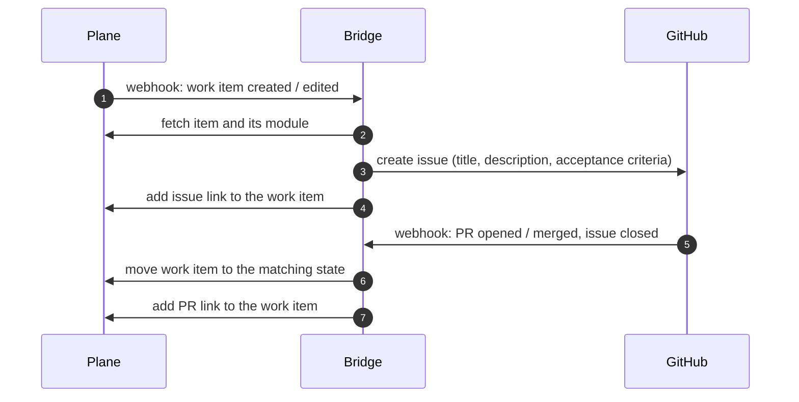

<div align="center">

# ⇄ plane-github-bridge

**Plan in Plane. Build in GitHub. Never update a board by hand.**

A small, self-hosted webhook service that links [Plane](https://plane.so) Community Edition work items to GitHub issues, built by [D5-Interactive](https://github.com/D5-Interactive).

[](https://github.com/D5-Interactive/plane-github-bridge/actions/workflows/ci.yml)
[](LICENSE)
[](https://www.python.org/)
[](https://github.com/astral-sh/uv)
[](https://fastapi.tiangolo.com/)
[](docker-compose.yml)
[](https://github.com/makeplane/plane)

[How it works](#-how-it-works) ·
[Installation](#-installation) ·
[Setup](#-setup) ·
[Team workflow](#-team-workflow) ·
[Limits](#-limits) ·
[Development](#-development)

</div>

---

## ◆ Why

Plane's built-in GitHub sync is a paid feature. This bridge gives Community
Edition the part that matters for a Scrum team:

- ▸ **Plane is where tasks are planned.** Write the task, its acceptance
  criteria and its estimate in Plane, inside a module that's mapped to a repo.
- ▸ **GitHub is where the code work happens.** The bridge creates the issue, and
  branches, commits and PRs attach to it the normal GitHub way.
- ▸ **Progress flows back on its own.** Opening, reviewing and merging PRs moves
  the work item across the sprint board.

## ◆ How it works



Both sides send webhooks **to the bridge**; the bridge is the only thing that
holds API keys for both. Every webhook is checked against its HMAC signature
before anything happens.

### State mapping

| On GitHub | Work item moves to |
|---|---|
| PR that says `Closes #N` opened as a draft | ◐ In Progress |
| PR ready for review | ◑ In Review |
| PR closed without merging, or converted to draft | ◐ In Progress |
| PR merged, or issue closed as completed | ● Done |
| Issue closed as not planned | ✕ Cancelled |
| Issue reopened | ○ Todo |

A PR counts as belonging to a work item if it says `Closes #N` for the linked
issue, or if its branch is named after the issue (`12-scan-command`).

### Activity feed

GitHub already shows branches, commits, PRs, reviews and merges on the issue.
The bridge copies that activity onto the Plane work item as comments, so the
same history is visible from either side:

| GitHub activity | Shows on the work item as |
|---|---|
| Branch created for the issue | ◆ comment + branch link |
| Commits pushed to the issue's branch, or mentioning `#N` | ◆ comment listing each commit |
| PR opened, ready for review, closed, reopened | ◆ comment + PR link |
| PR review: approved, changes requested, commented | ◆ comment |
| PR merged | ◆ comment, and the item moves to Done |

Each event is posted once, even if GitHub redelivers it.

### Edits

Edits to a work item's **title or description** in Plane are copied to its
issue. Edits made on the GitHub issue are **not** copied back: Plane is the
source of truth for the task itself.

## ◆ Installation

Everything runs on the Plane server, next to Plane. Clone the repo there:

```bash
cd ~
git clone https://github.com/D5-Interactive/plane-github-bridge.git
cd plane-github-bridge
```

**Requirements:**

- Docker with Compose v2
- A running Plane Community Edition instance on the same machine
- A GitHub organization (or personal account) that owns the repos to sync
- A way to give the bridge a public HTTPS address, such as a Cloudflare Tunnel
  or a reverse proxy

## ◆ Setup

The examples below use placeholder names. Replace them with your own:

| Placeholder | Means |
|---|---|
| `your-org` | Your GitHub organization (or username) |
| `plane.example.com` | The address your team uses to open Plane |
| `hooks.example.com` | The public address you give the bridge in step 5 |
| `your-workspace` | Your Plane workspace slug |

### 1. Create your config

```bash
cp .env.example .env
cp config.example.yaml config.yaml
chmod 600 .env
```

You now have two files to fill in over the next steps:

| File | What goes in it |
|---|---|
| `.env` | Secrets: API tokens and webhook secrets. Never commit it. |
| `config.yaml` | Which Plane projects and modules sync to which repos |

Open `config.yaml` (`nano config.yaml`) and map Plane projects and modules to repos:

```yaml
mappings:
  - project: API             # Plane project identifier (the prefix in API-12)
    module: Auth             # optional: only items in this module sync
    repo: your-org/auth-service
```

A module mapping wins over a project-wide one.

### 2. Plane API token

In Plane: your avatar → **Profile settings** → **Personal access tokens**
(called API tokens in some versions) → create one and copy it.

Open `.env` (`nano .env`) and paste it after `PLANE_API_KEY=`, with no quotes
or spaces:

```bash
PLANE_API_KEY=plane_api_0123456789abcdef
```

While you're in `.env`, fill in the three lines above it:

```bash
PLANE_BASE_URL=http://localhost:80              # Plane's port on this machine (LISTEN_HTTP_PORT in plane.env)
PLANE_PUBLIC_URL=https://plane.example.com      # the address your team opens Plane at
PLANE_WORKSPACE=your-workspace                  # the part after plane.example.com/ in your browser
```

> [!NOTE]
> The bridge acts as this user, so use an account that's a member of every
> mapped project.

### 3. GitHub token

Fine-grained tokens are created from a **user account**, then pointed at the
org. Sign in as the account the issues should come from: your own, or a
dedicated bot account if you'd rather the issues not show your name.

Create the token at <https://github.com/settings/personal-access-tokens/new>
(your avatar → **Settings → Developer settings → Personal access tokens →
Fine-grained tokens**):

| Setting | Value |
|---|---|
| Resource owner | `your-org` (not your username) |
| Repository access | Only the repos in `config.yaml` |
| Permissions | **Issues → Read and write** (Metadata → Read is added automatically) |

That one permission is enough. Commits, branches, PRs and reviews reach the
bridge inside GitHub's webhook payloads (step 7), so the token never reads
them. Keeping it to Issues means a leaked token can't touch your code.

> [!NOTE]
> If `your-org` doesn't appear under Resource owner, an org owner has to allow
> fine-grained tokens first: **Org settings → Personal access tokens →
> Settings**. If the org requires approval, the owner then approves the token
> under **Pending requests**.

Then make up a secret for the GitHub webhook:

```bash
openssl rand -hex 32
```

Put both in `.env`:

```bash
GITHUB_TOKEN=github_pat_0123456789abcdef
GITHUB_WEBHOOK_SECRET=<the output of openssl rand -hex 32>
```

Leave `PLANE_WEBHOOK_SECRET` empty for now; Plane gives you that one in step 6.
Until then the bridge starts but turns away Plane webhooks.

### 4. Start the bridge

```bash
docker compose up -d --build
curl http://127.0.0.1:8095/health
# {"ok":true,"mappings":1,"plane_webhook_ready":false}   (true after step 6)
```

### 5. Give it a public address

Plane and GitHub need to reach the bridge over HTTPS. Point a hostname such as
`hooks.example.com` at `http://localhost:8095` on this machine.

**With a Cloudflare Tunnel:** Zero Trust → **Networks → Tunnels** → your tunnel
→ **Add route → Published application**:

| Field | Value |
|---|---|
| Subdomain | `hooks` |
| Domain | `example.com` |
| Service URL | `http://localhost:8095` |

**With a reverse proxy** such as Caddy:

```
hooks.example.com {
    reverse_proxy 127.0.0.1:8095
}
```

> [!TIP]
> The bridge only listens on `127.0.0.1`, so your tunnel or proxy is the only
> way in. Only `/plane/webhook`, `/github/webhook` and `/health` exist, and both
> webhooks reject anything without a valid signature.

### 6. Plane webhook

Plane → **Workspace settings → Webhooks → Add webhook**:

| Field | Value |
|---|---|
| URL | `https://hooks.example.com/plane/webhook` |
| Events | Work items (issues) only |

Plane shows a secret that starts with `plane_wh_`. Put it in `.env`:

```bash
PLANE_WEBHOOK_SECRET=plane_wh_0123456789abcdef
```

Then restart the bridge so it reads the new value:

```bash
docker compose up -d --force-recreate
```

### 7. GitHub webhook

GitHub → **your-org → Settings → Webhooks → Add webhook**. One org webhook covers
every repo, including ones you add later. Without org owner access, add the same
webhook to each mapped repo under **Repo settings → Webhooks** instead.

| Field | Value |
|---|---|
| Payload URL | `https://hooks.example.com/github/webhook` |
| Content type | `application/json` |
| Secret | the `GITHUB_WEBHOOK_SECRET` value from `.env` |
| Events | **Let me select** → ✓ Issues, ✓ Pull requests, ✓ Pull request reviews, ✓ Pushes, ✓ Branch or tag creation |

GitHub sends a ping right away; it should show a green check.

### 8. Try it

Create a work item in a mapped module. Within a few seconds a GitHub issue
appears and its link shows on the work item.

```bash
docker compose logs -f bridge
```

> [!IMPORTANT]
> If nothing happens, set `LOG_LEVEL=DEBUG` in `.env`, restart, and try again.
> The log then shows each Plane payload exactly as received.

## ◆ Team workflow

1. **Plan in Plane.** Create the task in the right module and write the
   acceptance criteria as a checklist; it becomes a checklist on the GitHub issue.
2. **Branch from the issue.** On the GitHub issue: **Development → Create a
   branch**. GitHub names it like `12-scan-command`, which links the branch, its
   commits and its PR to the work item automatically.
3. **Close it from the PR.** Put `Closes #<issue number>` in the PR description.
   Commits on other branches show up too if their message mentions `#12`.
4. **Hands off the board.** Leave the Plane state alone; the bridge moves it.

## ◆ Limits

- Only work items in mapped projects/modules sync. Adding an item to a mapped
  module later also creates its issue.
- Deleting a work item doesn't delete or close its issue.
- A PR only moves a work item if it says it closes the linked issue or its
  branch is named after it.
- Commit and review comments only reach Plane for issues the bridge created.
- State names should be **Todo, In Progress, In Review, Done** and
  **Cancelled**. Otherwise the bridge falls back to the first state in the
  matching state group.

## ◆ Development

The project uses [uv](https://docs.astral.sh/uv/) and Python 3.14.

```bash
uv sync            # create .venv with all dependencies
uv run pytest      # run the tests
uv add <package>   # add a dependency (updates pyproject.toml and uv.lock)
```

Run it locally without Docker:

```bash
cp .env.example .env && cp config.example.yaml config.yaml   # then fill them in
set -a && . ./.env && set +a
BRIDGE_CONFIG=config.yaml BRIDGE_DB=bridge.db \
  uv run uvicorn bridge.app:create_app --factory --port 8095
```

### Project layout

```
bridge/
├── app.py       # FastAPI app: webhook endpoints + signature checks
├── sync.py      # the sync rules (Plane → GitHub, GitHub → Plane)
├── clients.py   # Plane and GitHub REST clients
├── render.py    # HTML → Markdown, closing-reference parsing, signatures
├── store.py     # SQLite: item ↔ issue links, delivery de-duplication
└── config.py    # environment settings + config.yaml mappings
tests/           # pytest suite with fake Plane and GitHub APIs
```

## ◆ License

[MIT](LICENSE) © D5i
